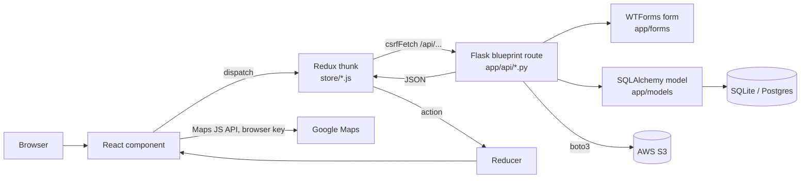
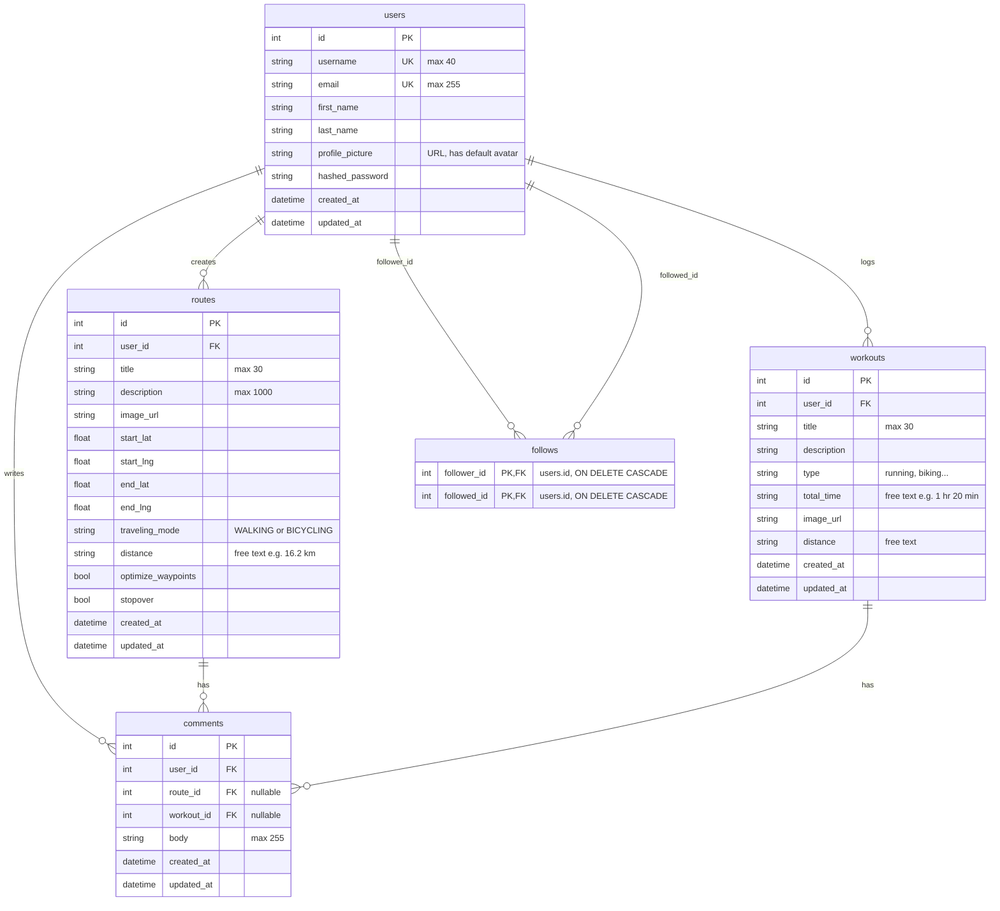
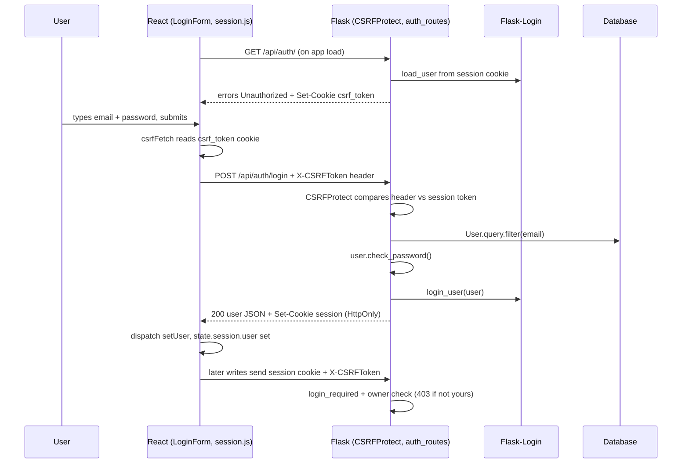
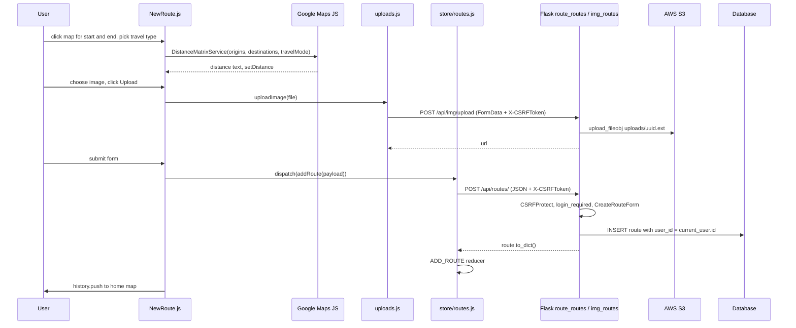

# Aktiv - Guided Code Walkthrough

This is a guided tour of the Aktiv codebase (a Strava clone) as it is **right now on the `modernize` branch**, after the Batch 1 fixes (A1-A15) in `CHANGES.md`. Use it to get your bearings again, to debug the app, and to prepare for interview questions about it.

Read it top to bottom once. After that, use sections 8 (traces) and 9 (debugging cheat sheet) as a reference.

## Table of contents

1. [The app in one minute](#1-the-app-in-one-minute)
2. [Folder map](#2-folder-map)
3. [How to run it locally](#3-how-to-run-it-locally)
4. [Data model](#4-data-model)
5. [Backend tour](#5-backend-tour)
6. [Authentication and security flow](#6-authentication-and-security-flow)
7. [Frontend tour](#7-frontend-tour)
8. [Three end-to-end traces](#8-three-end-to-end-traces)
9. [Where do I look when...](#9-where-do-i-look-when)
10. [What changed in Batch 1 and what is coming](#10-what-changed-in-batch-1-and-what-is-coming)
11. [Interview prep](#11-interview-prep)
12. [Glossary](#12-glossary)

---

## 1. The app in one minute

**What it does.** Aktiv lets people sign up, drop a start and end point on a Google Map to save a **route** (walking or bicycling), log a **workout** (type, time, distance, photo), comment on routes, add other users as **friends**, and see an **activity feed** of their friends' routes and workouts. A public demo account (`demo@aa.io` / `password`) lets anyone try it.

**The stack.**

| Layer | Technology | Where |
|---|---|---|
| Frontend | React 17, React Router 5, Redux 4 + redux-thunk, Create React App 4 | `react-app/` |
| Maps | Google Maps JavaScript API via `@react-google-maps/api` | map components in `react-app/src/components/` |
| Backend | Flask 2.0, Flask-SQLAlchemy 2.5 (SQLAlchemy 1.4), Flask-Login 0.5, Flask-WTF 0.15, Flask-Migrate (Alembic) | `app/` |
| Database | SQLite locally (`app/dev.db`), Postgres in production | `migrations/` |
| File storage | AWS S3 via boto3 (image uploads) | `app/s3_helpers.py` |

**How a request flows.** Every user action follows the same path: a React component calls `dispatch(someThunk())`; the thunk (in `react-app/src/store/*.js`) calls `fetch` / `csrfFetch` on a `/api/...` URL; Flask routes the URL to a function in a **blueprint** (`app/api/*.py`); that function uses a **form** to validate input and a **SQLAlchemy model** to read or write the database; it returns JSON; the thunk dispatches an action; the **reducer** updates the Redux store; components re-render.



Note that **Google Maps is called from the browser**, not from Flask. Flask never talks to Google today; it only stores latitude/longitude numbers and a distance string.

---

## 2. Folder map

Skipped: `node_modules/`, `react-app/build/`, virtualenvs, lockfiles, CSS files (each component has a matching `.css`).

```text
Strava-Capstone-Clone/
├── .env.example              # Template for backend env vars (copy to .env)
├── .flaskenv                 # FLASK_APP=app, FLASK_DEBUG=1 (read by `flask` CLI)
├── CHANGES.md                # What Batch 1 (A1-A15) changed and how to verify it
├── MODERNIZATION_PLAN.md     # All 58 planned improvements (A1-A58)
├── requirements.txt          # Python runtime dependencies (source of truth)
├── requirements-dev.txt      # autopep8 etc.
├── Pipfile / Pipfile.lock    # Older pipenv files (lock is stale; A16 removes them)
├── app/
│   ├── __init__.py           # Creates the Flask app: config, login, blueprints, CSRF, React serving
│   ├── config.py             # APP_ENV + Development/Testing/Production config classes
│   ├── s3_helpers.py         # Image validation (Pillow) and S3 upload (boto3)
│   ├── dev.db                # Local SQLite database (git-ignored, created by you)
│   ├── api/                  # Blueprints = groups of API endpoints
│   │   ├── auth_routes.py    # /api/auth: session restore, login, logout, signup, profile picture
│   │   ├── route_routes.py   # /api/routes: route CRUD + route comments
│   │   ├── workout_routes.py # /api/workouts: workout CRUD + add workout comment
│   │   ├── comments_routes.py# /api/comments: read/edit/delete any comment by id
│   │   ├── user_routes.py    # /api/users: users, their data, add/remove friend
│   │   ├── me_routes.py      # /api/me/friends/activity: the feed data
│   │   └── img_routes.py     # /api/img/upload: image upload to S3
│   ├── forms/                # Flask-WTF forms = server-side validation
│   │   ├── login_form.py, signup_form.py, route_form.py, workout_form.py, comment_form.py
│   ├── models/               # SQLAlchemy models = database tables
│   │   ├── db.py             # db object, environment, SCHEMA, add_prefix_for_prod()
│   │   ├── user.py           # User + the `follows` association table
│   │   ├── route.py, workout.py, comment.py
│   └── seeds/                # `flask seed all` / `flask seed undo` demo data
│       ├── __init__.py       # The CLI group; production TRUNCATE logic lives here
│       ├── users.py, routes.py, workouts.py, comments.py
├── migrations/               # Alembic (Flask-Migrate)
│   ├── env.py                # Creates/uses the Postgres SCHEMA in production
│   └── versions/
│       ├── 0a0f8863271d_.py               # Initial schema (2022)
│       └── b7c1e9a4d2f3_reconcile_models.py # A15: follows PK, drop workouts.route_id, timestamp defaults
└── react-app/
    ├── package.json          # Dependencies + "proxy": "http://localhost:5000"
    ├── .env.example          # REACT_APP_GOOGLE_MAPS_API_KEY template
    ├── public/index.html     # The single HTML page
    └── src/
        ├── index.js          # Entry: creates the store, wraps <App/> in Provider + ModalProvider
        ├── App.js            # Session restore, data preload, all URL routes
        ├── config.js         # GOOGLE_MAPS_API_KEY (baked in at build time)
        ├── context/Modal.js  # Tiny modal system (React portal)
        ├── store/            # Redux: one file per slice (actions + thunks + reducer)
        │   ├── index.js      # combineReducers + thunk (+ logger in dev)
        │   ├── csrf.js       # csrfFetch(): fetch + X-CSRFToken header
        │   ├── session.js, routes.js, workouts.js, comments.js,
        │   ├── users.js, friends.js, friendsActivity.js, uploads.js
        └── components/
            ├── NavBar.js, Footer.js, NotFound.js
            ├── auth/              # LoginForm, SignUpForm, LogoutButton, ProtectedRoute
            ├── HomePage/ + Map/   # Home page: one big map with a marker per route
            ├── NewMap/NewRoute.js # Create a route by clicking the map
            ├── RouteDisplay/      # One route: directions on a map + details + comments
            ├── MapAdjustment/     # Edit/delete route modals (EditMapForm has its own map)
            ├── NewWorkout/        # Log a workout form
            ├── WorkoutDisplay/    # One workout + edit/delete modals
            ├── ActivityFeed/      # Feed of friends' (or everyone's) routes + workouts
            ├── Comments/, AddCommentForm/, AddCommentModal/, EditComment/, EditCommentForm/
            ├── User.js, AdjustFriendStatus/  # Profile page + add/remove friend
            ├── ImageUploadComponenet/        # (sic - typo in folder name) file picker + upload
            ├── UsersList.js, UserRoutes/Routes.js  # Simple list pages (see bugs in section 7)
```

---

## 3. How to run it locally

You need **two terminals**: one for Flask (port 5000), one for the React dev server (port 3000). You use the app at `http://localhost:3000`.

### Backend (terminal 1)

1. **Python version.** The Pipfile says Python 3.9 and the pins in `requirements.txt` are old (Flask 2.0.1 etc.). Use Python 3.9 if you can (`pyenv install 3.9`). Newer Pythons may fail to install some of these pinned versions; A16 moves the project to Python 3.12.
2. **Create and activate a virtualenv** in the project root:
   ```bash
   python3.9 -m venv .venv
   source .venv/bin/activate
   ```
3. **Install dependencies:**
   ```bash
   pip install -r requirements.txt -r requirements-dev.txt
   ```
   `psycopg2==2.9.5` (the Postgres driver) is the source build, so it needs the Postgres client headers (`brew install libpq` / `apt install libpq-dev`). If it fails and you only use SQLite locally, you can temporarily `pip install psycopg2-binary==2.9.5` instead (A17 makes that switch permanently).
4. **Create `.env`** from the template and fill it in:
   ```bash
   cp .env.example .env
   python -c "import secrets; print(secrets.token_hex(32))"   # paste as SECRET_KEY
   ```
   The important variables:

   | Variable | Example | What reads it |
   |---|---|---|
   | `APP_ENV` | `development` | `app/config.py` `get_app_env()` picks the config class. (`FLASK_ENV` still works as a fallback.) |
   | `SECRET_KEY` | 64 hex chars | Signs the session cookie and CSRF token. Placeholder = warning in dev, crash in production (`check_secret_key()`). |
   | `DATABASE_URL` | `sqlite:///dev.db` | `get_database_url()`. The relative SQLite path ends up as `app/dev.db`. Missing = clear `RuntimeError` at startup. |
   | `SCHEMA` | `flask_schema` | Only used when `APP_ENV=production` (Postgres schema on Render). |
   | `S3_BUCKET`, `AWS_REGION` | `my-bucket`, `us-west-2` | `app/s3_helpers.py`. Credentials come from `~/.aws` or `AWS_ACCESS_KEY_ID`/`AWS_SECRET_ACCESS_KEY`, not from `.env` keys named `S3_KEY`. Only needed to test uploads. |
   | `SQLALCHEMY_ECHO` | `0` | Optional: silences the SQL log in development. |

   The `flask` command loads `.flaskenv` and `.env` automatically (python-dotenv).
5. **Build the database** (this runs the Alembic migrations in `migrations/versions/`):
   ```bash
   flask db upgrade
   ```
   Do **not** run `flask db migrate` as part of setup (the old README says to). `migrate` *generates a new migration file* by comparing models to the DB; you only run it when you change a model.
6. **Seed demo data:**
   ```bash
   flask seed all
   ```
   Running it a second time without `flask seed undo` first fails with a UNIQUE constraint error (the demo users already exist). To reset: `flask seed undo && flask seed all`.
7. **Start Flask:**
   ```bash
   flask run        # http://localhost:5000, debugger + auto-reload from FLASK_DEBUG=1
   ```

### Frontend (terminal 2)

1. Maps key: copy `react-app/.env.example` to `react-app/.env.local` and set `REACT_APP_GOOGLE_MAPS_API_KEY=...` (a browser key restricted to `http://localhost:3000/*`; see A12 in `CHANGES.md`). Without it the app works but maps show nothing and the console warns `REACT_APP_GOOGLE_MAPS_API_KEY is not set`.
2. Install and start:
   ```bash
   cd react-app
   npm install
   npm start            # Node 17+: NODE_OPTIONS=--openssl-legacy-provider npm start
   ```
   CRA 4 uses webpack 4, which needs the OpenSSL flag on modern Node. Vite (A19) removes that.
3. Open `http://localhost:3000` and click **DemoUser** (or log in with `demo@aa.io` / `password`).

### Why two ports work: the CRA proxy

`react-app/package.json` contains `"proxy": "http://localhost:5000"`. When the React dev server on port 3000 receives a request it cannot serve itself (like `/api/routes/`), it forwards it to Flask on port 5000. To the browser, everything comes from `localhost:3000`, so cookies are first-party and **no CORS is needed** (which is why A10 could delete Flask-Cors).

In production there is only one server: Flask serves the built React files from `react-app/build` (see `react_root` in section 5) plus the API on the same domain.

---
## 4. Data model

Five tables: four model classes plus the `follows` association table.



Things to notice:

- **Workouts are not linked to routes.** A15 dropped the unused `workouts.route_id` column. A workout is just a log entry.
- **A comment belongs to either a route or a workout** (one of `route_id` / `workout_id` is set). Nothing in the database enforces "exactly one".
- **Distance and time are strings**, not numbers (`"16.2 km"`, `"1 hr 20 min"`). You cannot sum or sort them. A31 plans numeric columns.
- **Friendship = two `follows` rows**, one per direction. The add-friend endpoint writes both.

### Notes per model file

- **`app/models/db.py`** - Creates the single `db = SQLAlchemy()` object that every model imports. Also defines `environment` (from `get_app_env()`), `SCHEMA` (env var) and `add_prefix_for_prod("users.id")`, which turns foreign key targets into `flask_schema.users.id` in production. This is the "Render pattern": production tables live in a named Postgres schema. A47 plans to remove it.
- **`app/models/__init__.py`** - Re-exports `db`, `User`, `Route`, `Comment`, `Workout` so other code can write `from app.models import User, db`.
- **`app/models/user.py`** - `User(db.Model, UserMixin)`. `UserMixin` gives Flask-Login the `is_authenticated` / `get_id()` methods it needs. The `password` property setter hashes with Werkzeug's `generate_password_hash`; `check_password()` verifies. The self-referencing `followers` relationship goes through `follows`: `user.followers` = the users who have a row "follower -> user". `to_dict()` returns the user **plus every route, workout and comment they own (each fully serialized) plus their friends**. That deep nesting is why `/api/auth/` is slow (A24).
- **`app/models/route.py`** - `Route`. `EDITABLE_FIELDS` + `set_kwargs()` (added in A3) make sure an update can only touch whitelisted columns, never `user_id`. `to_dict()` reshapes columns for the frontend: `startingPoint`/`endingPoint` objects, a `requestData` object that is already in the shape Google's `DirectionsService` expects, nested `comments`, and `ownerInfo` (the author's name/picture/email).
- **`app/models/workout.py`** - `Workout`, same pattern as `Route` (`EDITABLE_FIELDS`, `set_kwargs()`, `to_dict()` with `comments` and `ownerInfo`).
- **`app/models/comment.py`** - `Comment`. `to_dict()` returns either `routeId` or `workoutId` depending on which parent is set, plus a small `user` object (`username`, `profilePicture`).

Relationship names are plural even when they point to one object (`comment.users`, `route.users`). That is a naming quirk from 2023, not a many-to-many.

---

## 5. Backend tour

### 5.1 `app/__init__.py`, step by step

This file builds the app at import time (there is no `create_app()` factory yet; A16 adds one). In order:

1. **Imports** the models, every blueprint, the seed CLI group and the config helpers.
2. **Creates the app:** `Flask(__name__, static_folder='../react-app/build', static_url_path='/')`. The static folder is the **React production build**. That is how one Flask process serves both the API and the frontend in production.
3. **Login manager:** `login = LoginManager(app)` and `login.login_view = 'auth.unauthorized'`. When a `@login_required` view is hit without a session, Flask-Login **redirects (302)** to `/api/auth/unauthorized`, which returns `{"errors": ["Unauthorized"]}` with 401. `fetch` follows the redirect, so the frontend sees a 401.
4. **`load_user(id)`** (`@login.user_loader`): on each request, Flask-Login reads the user id from the signed session cookie and calls this to get the `User` row. That object becomes `current_user`.
5. **Seed commands:** `app.cli.add_command(seed_commands)` registers `flask seed all|undo`.
6. **Config:** `app.config.from_object(get_config(APP_ENV))` picks `DevelopmentConfig`, `TestingConfig` or `ProductionConfig` from `app/config.py`. Then `check_secret_key()` (crashes in production on a missing/placeholder key) and a check that `SQLALCHEMY_DATABASE_URI` is set.
7. **Blueprints:** seven `register_blueprint` calls mount each `app/api/*.py` file under its URL prefix (`/api/users`, `/api/auth`, `/api/routes`, `/api/workouts`, `/api/comments`, `/api/img`, `/api/me`).
8. **Extensions:** `db.init_app(app)` connects SQLAlchemy; `Migrate(app, db)` adds the `flask db ...` commands.
9. **CSRF:** `csrf = CSRFProtect(app)` makes **every** POST/PUT/PATCH/DELETE require a valid `X-CSRFToken` header. `handle_csrf_error` turns failures into JSON 400 `{"errors": ["CSRF token missing or invalid. ..."]}`.
10. **`inject_csrf_token`** (`@app.after_request`): on **every** response, sets a `csrf_token` cookie containing `generate_csrf()`. It is deliberately **not** HttpOnly so JavaScript can read it. Details in section 6.
11. **`/api/docs`** (`api_help`): lists every URL rule and its docstring. Disabled (404) in production unless `ENABLE_API_DOCS=1`. Handy locally: open `http://localhost:5000/api/docs`.
12. **`react_root`**: the catch-all `GET /` and `GET /<path:path>`. It returns `index.html` from the React build for any path no other rule matched, so that React Router can handle URLs like `/routes/5` after a browser refresh. (The `favicon.ico` branch calls `app.send_from_directory`, which does not exist; it is a latent bug, but in practice `/favicon.ico` is served by the static route first. A17 fixes it.)
13. **Error handlers:** 413 (upload too large) returns JSON `{"errors": "File is too large (max 5 MB)"}`. 404 returns `index.html`.

The config classes in **`app/config.py`**: `Config` holds shared settings (cookie flags `HttpOnly`/`SameSite=Lax`, `MAX_CONTENT_LENGTH = 5 MB`, `WTF_CSRF_TIME_LIMIT = None`, `pool_pre_ping`). `DevelopmentConfig` turns SQL echo on. `TestingConfig` uses in-memory SQLite. `ProductionConfig` sets `Secure` cookies and turns `/api/docs` off. `get_config()` raises a clear error for an unknown `APP_ENV`.

### 5.2 Forms (`app/forms/`)

Flask-WTF forms do **server-side validation**. Even though the frontend sends JSON, `FlaskForm()` reads `request.get_json()` automatically, so `form.validate_on_submit()` works. With global `CSRFProtect`, the form's own CSRF check is skipped for requests that already passed it.

| Form | Fields and rules | Used by |
|---|---|---|
| `LoginForm` | `email`, `password` (required, max 255). The actual email/password check is in the view so both failures return the same message (A9). | `auth_routes.login` |
| `SignUpForm` | `username` (max 40, `username_exists`), `email` (`Email()`, `user_exists`), `password` (min 8), optional `profile_picture`, `first_name`, `last_name` | `auth_routes.sign_up` |
| `CreateRouteForm` | `title` (30), `description` (1000), `start_lat/lng`, `end_lat/lng` (`FloatField`), `traveling_mode`, `distance`, `image_url` - all required | add and update route |
| `CreateWorkoutForm` | `title`, `description`, `type`, `total_time`, `image_url`, `distance` - all required | add and update workout |
| `CreateCommentForm` | `body` (required, max 255) | all comment create/edit |

Each blueprint has its own copy of `validation_errors_to_error_messages()`, which flattens `form.errors` into strings like `"title : Field cannot be longer than 30 characters."`.

Gotcha: `FloatField` + `DataRequired` rejects `0.0`, so a point exactly on the equator or the prime meridian would fail validation. Not a real-world problem for this app, but a good "spot the bug" talking point.

### 5.3 Every API endpoint

All responses are JSON. "Login" = `@login_required` (401 via redirect if not logged in). "Owner" = returns 403 if the record belongs to someone else. All write methods also need the `X-CSRFToken` header. Error bodies are `{"errors": [...]}` unless noted.

| Method | Path | Login | Owner | Handler | Models | Success response |
|---|---|---|---|---|---|---|
| GET | `/api/auth/` | no | - | `auth_routes.authenticate` | User | User `to_dict()` + `nonFriends` list. **Logged out: 200 with `{"errors": ["Unauthorized"]}`** (not 401). |
| POST | `/api/auth/login` | no | - | `auth_routes.login` | User | Same as above. Bad credentials: 401 `Invalid email or password`. |
| GET | `/api/auth/logout` | no | - | `auth_routes.logout` | - | `{"message": "User logged out"}` (still a GET; see A6 notes) |
| POST | `/api/auth/signup` | no | - | `auth_routes.sign_up` | User | User `to_dict()`; logs the new user in. 400 on validation errors. |
| PUT | `/api/auth/profile-picture` | yes | self | `auth_routes.set_profile_picture` | User | `{"profilePicture": url}`. Only accepts URLs under your bucket's `uploads/`. |
| GET | `/api/auth/unauthorized` | no | - | `auth_routes.unauthorized` | - | 401 `{"errors": ["Unauthorized"]}` (Flask-Login redirect target) |
| GET | `/api/routes/` | yes | - | `route_routes.all_routes` | Route, Comment, User | `{"routes": [route, ...]}` |
| POST | `/api/routes/` | yes | - | `route_routes.add_route` | Route | The new route `to_dict()`. `user_id` comes from `current_user`, not the body. |
| GET | `/api/routes/<id>` | yes | - | `route_routes.one_route` | Route | route `to_dict()`, 404 if missing |
| PUT | `/api/routes/<id>` | yes | yes | `route_routes.update_route` | Route | updated route |
| DELETE | `/api/routes/<id>` | yes | yes | `route_routes.delete_route` | Route (+ its comments via cascade) | `{"message": "Success"}` |
| GET | `/api/routes/<id>/comments` | yes | - | `route_routes.get_comments_to_route` | Route, Comment | `{"comments": [...]}` |
| POST | `/api/routes/<id>/comments` | yes | - | `route_routes.add_comment_to_route` | Comment | new comment `to_dict()` |
| GET | `/api/workouts/` | yes | - | `workout_routes.all_workouts` | Workout | `{"workouts": [...]}` |
| POST | `/api/workouts/` | yes | - | `workout_routes.add_workout` | Workout | new workout `to_dict()` |
| GET | `/api/workouts/<id>` | yes | - | `workout_routes.one_workout` | Workout | workout `to_dict()` |
| PUT | `/api/workouts/<id>` | yes | yes | `workout_routes.update_workout` | Workout | updated workout |
| DELETE | `/api/workouts/<id>` | yes | yes | `workout_routes.delete_workout` | Workout | `{"message": "Success"}` |
| POST | `/api/workouts/<id>/comments` | yes | - | `workout_routes.add_comment_to_workout` | Comment | new comment. (There is **no GET** on this URL; see open questions.) |
| GET | `/api/comments/` | yes | - | `comments_routes.all_comments` | Comment | `{"comments": [...]}` |
| GET | `/api/comments/<id>` | yes | - | `comments_routes.one_comment` | Comment | comment `to_dict()` |
| PUT | `/api/comments/<id>` | yes | yes | `comments_routes.update_comment` | Comment | updated comment |
| DELETE | `/api/comments/<id>` | yes | yes | `comments_routes.delete_comment` | Comment | `{"message": "Success"}` |
| GET | `/api/users/` | yes | - | `user_routes.users` | User (+ everything nested) | `{"users": [...]}` |
| GET | `/api/users/<id>` | yes | - | `user_routes.user` | User | user `to_dict()` |
| GET | `/api/users/<id>/routes` | yes | - | `user_routes.user_route` | User, Route | `{"routes": [...]}` |
| GET | `/api/users/<id>/comments` | yes | - | `user_routes.user_comments` | User, Comment | `{"comments": [...]}` |
| GET | `/api/users/<id>/workouts` | yes | - | `user_routes.user_workouts` | User, Workout | `{"workouts": [...]}` |
| GET | `/api/users/<id>/friends` | yes | - | `user_routes.user_friends` | User, follows | `{"friends": [{userId, username, profilePicture}]}` |
| POST | `/api/users/<id>/friends` | yes | - | `user_routes.add_user_friends` | User, follows | `{"friend": user, "currUser": user}`. 400 self, 404 missing, 409 already friends. |
| DELETE | `/api/users/<id>/friends` | yes | - | `user_routes.unfriend_user` | User, follows | `{"unFriended": user, "currUser": [friends]}` |
| GET | `/api/me/friends/activity` | yes | - | `me_routes.friend_activity` | User, Route, Workout | `{"routes": [...], "workouts": [...]}` for all friends, newest first per friend |
| POST | `/api/img/upload` | yes | - | `img_routes.upload_image` | - (S3) | `{"url": "https://<bucket>.s3.amazonaws.com/uploads/<uuid>.<ext>"}`. Errors here are a **string**: `{"errors": "file is not a valid image"}`. |
| GET | `/api/docs` | no | - | `__init__.api_help` | - | Map of URL -> [methods, docstring]. 404 in production. |
| GET | any other path | no | - | `__init__.react_root` | - | React `index.html` |

**Owner checks** follow the same shape everywhere (see `update_route` in `app/api/route_routes.py`): load with `Model.query.get(id)` -> `None` returns 404 -> `record.user_id != current_user.id` returns 403 -> only then validate the form and save.

### 5.4 `app/s3_helpers.py`

The upload pipeline used by `img_routes.upload_image`:

1. `allowed_file(filename)` - extension must be png/jpg/jpeg/gif/webp.
2. `detect_image(file)` - opens the bytes with **Pillow** and calls `verify()`. Returns `(ext, content_type)` from what Pillow detected, so a renamed `.html` file is rejected and the stored `Content-Type` cannot be faked.
3. `get_unique_filename()` - `uploads/<uuid4 hex>.<ext>`.
4. `upload_file_to_s3(file, content_type)` - `get_s3_client().upload_fileobj(...)` with no ACL. The boto3 client is created lazily on first use with the **default credential chain** (IAM role on EC2, `~/.aws` locally).
5. Returns `{"url": S3_LOCATION + key}`. `S3_LOCATION` is `S3_PUBLIC_URL` or `https://<S3_BUCKET>.s3.amazonaws.com/`.

`MAX_CONTENT_LENGTH` (5 MB) is enforced by Flask before your code runs and produces the JSON 413.

For uploaded images to be viewable, the bucket needs a public-read policy on `uploads/*` (see A5 in `CHANGES.md`).

### 5.5 Seeds and migrations

**Seeds** (`app/seeds/`) are the `flask seed` CLI commands:

- `seed_users()` creates 5 users (demo, marnie, bobbie, jimmy, tammie, all with password `password`) and their friendships by assigning `demo.followers = [...]`.
- `seed_routes()`, `seed_workouts()`, `seed_comments()` create rows with **hard-coded `user_id`s** (1-5). They assume the users got ids 1-5, which is only true on an empty table with reset ids.
- Seed images point at the old `capstone-strava-clone-aktiv` S3 bucket (plan open question 4).
- Each `undo_*()` runs `DELETE FROM <table>` on SQLite, or `TRUNCATE table <schema>.<table> RESTART IDENTITY CASCADE` in production.

> **Warning: `flask seed all` in production wipes all real data.** In `app/seeds/__init__.py`, when `environment == 'production'`, `seed()` first TRUNCATEs `users`, `routes`, `workouts` and `comments` (with `CASCADE`, which also empties `follows`), then calls every `undo_*()`, then re-seeds. That is the App Academy Render template behavior: it was meant for a demo database that is rebuilt on every deploy. If this command runs against a production database with real sign-ups (for example from a deploy script), **every user, route, workout and comment is deleted** and replaced by the 5 demo users. Never run it against a database you care about; take a `pg_dump` first. The raw-string `db.session.execute("TRUNCATE ...")` calls will also stop working on SQLAlchemy 2.0 until they are wrapped in `text()` (A18).

**Migrations** (`migrations/`) are managed by Flask-Migrate (a wrapper around Alembic):

- `0a0f8863271d_.py` - the initial schema from 2022 (users, follows, routes, workouts, comments).
- `b7c1e9a4d2f3_reconcile_models.py` - A15: drops `workouts.route_id`, rebuilds `follows` with a composite primary key and `ON DELETE CASCADE` (via a copy-and-rename `follows_new`), and adds database-side `CURRENT_TIMESTAMP` defaults. Has a working `downgrade()`.
- `migrations/env.py` - in production runs `CREATE SCHEMA IF NOT EXISTS {SCHEMA}` and `SET search_path TO {SCHEMA}` so tables go into the named schema.

Commands: `flask db upgrade` (apply), `flask db downgrade` (undo one), `flask db migrate -m "msg"` (generate a new migration after changing a model; always read the generated file), `flask db current` (where am I).

---
## 6. Authentication and security flow

Aktiv uses **cookie sessions**, not JWTs. Two cookies matter:

| Cookie | Set by | HttpOnly? | Purpose |
|---|---|---|---|
| `session` | Flask (signed with `SECRET_KEY`) | yes | Holds Flask-Login's user id (`_user_id`) and the raw CSRF token. JavaScript cannot read it. |
| `csrf_token` | `inject_csrf_token` in `app/__init__.py` on every response | **no** | A signed copy of the CSRF token that the frontend reads and echoes back in the `X-CSRFToken` header. |

Both use `SameSite=Lax` and become `Secure` (HTTPS only) when `APP_ENV=production`.

### Why the CSRF header works

A malicious site can make your browser *send* cookies to Aktiv, but it cannot *read* them (same-origin policy). Flask-WTF's `CSRFProtect` compares the `X-CSRFToken` header against the token stored inside the signed `session`. Only JavaScript running on Aktiv's own origin can read `csrf_token` and put it in the header, so forged requests fail with 400. `react-app/src/store/csrf.js` does this in `csrfFetch()`: for any method other than GET/HEAD/OPTIONS/TRACE, it reads the cookie with `getCsrfToken()` and adds the header.

(Before A6, every view copied the cookie into the form and compared it with... the same cookie, which protected nothing.)

### Step by step

**Restore session (every page load).** `App.js` `useEffect` -> `dispatch(authenticate())` (`store/session.js`) -> `GET /api/auth/` -> `authenticate()` in `auth_routes.py`. If the `session` cookie has a valid user id, Flask-Login's `load_user()` loads the user and the view returns `to_dict()` + `nonFriends`. Otherwise it returns `{"errors": [...]}` and the thunk returns `null`. Either way the response also sets the `csrf_token` cookie, so the browser has a token before the user submits anything.

**Login.** `LoginForm.onLogin` -> `login(email, password)` thunk -> `csrfFetch('POST /api/auth/login')` with the header -> `CSRFProtect` checks the header -> `auth_routes.login()` validates `LoginForm`, finds the user by email, `user.check_password()`, then `login_user(user)` writes the user id into the session -> response sets a new `session` cookie -> thunk dispatches `setUser(data)` -> `state.session.user` is set -> `LoginForm` sees `user` and `<Redirect to='/'>`.

**Signup.** `SignUpForm.onSignUp` checks passwords match -> `signUp(...)` thunk -> `POST /api/auth/signup` -> `SignUpForm` validators (unique email/username, `Email()`, min 8 chars) -> create `User` (password setter hashes it) -> `login_user` -> returns the user. If a picture was chosen, the component *then* calls `uploadImage()` and `setProfilePicture()` (`PUT /api/auth/profile-picture`) because uploads need a logged-in user, and finally `authenticate()` again to refresh the picture.

**Logout.** `LogoutButton.onLogout` -> `logout()` thunk -> `GET /api/auth/logout` -> `logout_user()` removes the user id from the session -> thunk dispatches `removeUser()` -> `history.push('/')`.

**Protected pages.** On the backend, `@login_required` guards every data endpoint. On the frontend, `components/auth/ProtectedRoute.js` renders its children only if `state.session.user` exists, otherwise redirects to `/`. The frontend check is only for UX; the backend check is the real one.

**Ownership.** Update/delete endpoints compare `record.user_id` with `current_user.id` and return 403 (section 5.3). Create endpoints take `user_id` from `current_user`, ignoring any `user_id` the frontend sends (the frontend does still send it in its payloads; it is harmless). `set_kwargs()` only touches `EDITABLE_FIELDS`.



Other security measures from Batch 1: generic login error plus a dummy hash check for unknown emails (no user enumeration, A9), form length limits (A9), 5 MB upload limit and Pillow verification (A4), no wildcard CORS (A10), `SECRET_KEY` guard (A1). Not done yet: rate limiting on login, logout as POST.

---

## 7. Frontend tour

### 7.1 Entry point

- **`react-app/public/index.html`** - the one HTML page with `<div id="root">`.
- **`react-app/src/index.js`** - `configureStore()` creates the Redux store, then `ReactDOM.render(...)` renders `<App />` wrapped in `<Provider store>` (makes Redux available) and `<ModalProvider>` (from `context/Modal.js`; a portal target for all the edit/delete/comment modals).
- **`react-app/src/App.js`** - on mount, awaits `authenticate()`; if a user comes back, `preload()` fetches all routes and workouts; only then sets `loaded` and renders. A second `useEffect` preloads after a later login and resets on logout. `preloadedFor` (a `useRef`) prevents refetching for the same user.

### 7.2 `App.js` routes

One flat `<Switch>` (React Router v5): the first matching route wins. `<NavBar />` and `<Footer />` render on every page.

| URL | Component | Who | What it shows |
|---|---|---|---|
| `/` | `HomePage` or `LoginForm` | anyone | Logged in: full-screen map with one marker per route (`Map/MapComponent.js`); click marker -> info window with link. Logged out: login form + DemoUser button. |
| `/sign-up` | `SignUpForm` | logged out (logged in -> redirect `/`) | Sign-up form with optional picture |
| `/login` | redirect to `/` | anyone | Kept for old links |
| `/users` | `UsersList` | protected | Plain list of usernames (not linked from the navbar; see bugs below) |
| `/users/:userId` | `User` | protected | Profile: picture, name, add/remove friend button, all their routes and workouts |
| `/routes` | `UserRoutes/Routes` | protected | Plain list of route titles (not linked from the navbar; see bugs below) |
| `/activity` | `ActivityFeed` | protected | Feed of friends' (dropdown: "Following") or everyone's routes and workouts |
| `/routes/:routeId` | `RouteDisplay` | protected | Map with directions, route details, owner info, comments; edit/delete if owner |
| `/workouts/:workoutId` | `WorkoutDisplay` | protected | Workout details, photo, comments; edit/delete if owner |
| `/newRoute` | `NewMap/NewRoute` | protected | Click-to-place map + form to create a route |
| `/newWorkout` | `NewWorkout/NewWorkout` | protected | Form to log a workout |
| anything else | `NotFound` | anyone | "Page not found" with a link home |

`NavBar.js` links to `/` ("Routes"), `/activity` ("Activity"), `/newRoute` ("+ Route"), `/newWorkout` ("+ Workout") when logged in, and `/`, `/sign-up` when logged out.

### 7.3 Redux store map

`store/index.js` combines seven reducers and adds `thunk` (plus `redux-logger` in development, which logs every action in the browser console - very useful for debugging). Each store file holds action types, action creators, thunks and the reducer together (the "ducks" pattern).

| State key | File | State shape | Thunks -> endpoint | Action types |
|---|---|---|---|---|
| `session` | `session.js` | `{ user: User or null }` (user includes `routes`, `workouts`, `comments`, `friends`, `nonFriends`) | `authenticate` -> GET `/api/auth/`; `login` -> POST `/api/auth/login`; `logout` -> GET `/api/auth/logout`; `signUp` -> POST `/api/auth/signup` | `session/SET_USER`, `session/REMOVE_USER` |
| `routes` | `routes.js` | `{ routes: {id: route} or null, currentRoute: route or null }` | `getAllRoutes` -> GET `/api/routes/`; `getCurrentRoute(id)` -> GET `/api/routes/<id>`; `addRoute` -> POST `/api/routes/`; `updateRoute` -> PUT `/api/routes/<id>`; `deleteRoute` -> DELETE `/api/routes/<id>` | `workouts/GET_ROUTES` etc. (the prefix says "workouts" - copy-paste leftover, harmless) |
| `workouts` | `workouts.js` | `{ workouts: {id: workout} or null, currentWorkout }` | `getAllWorkouts`, `getCurrentWorkout`, `addWorkout`, `updateWorkout`, `deleteWorkout` -> `/api/workouts/...` | `workouts/GET_WORKOUTS`, ... |
| `comments` | `comments.js` | `{ id: comment }` (only the comments of the page you are on) | `getRouteComments` -> GET `/api/routes/<id>/comments`; `getWorkoutComments` -> GET `/api/workouts/<id>/comments` (**no such backend route: 405; also unused**); `newRouteComment` -> POST `/api/routes/<id>/comments`; `newWorkoutComment` -> POST `/api/workouts/<id>/comments` (unused by components); `updateComment` -> PUT `/api/comments/<id>`; `deleteComment` -> DELETE `/api/comments/<id>` | `comments/GET_COMMENTS`, ... |
| `users` | `users.js` | `{ users: {id: user} or null, currentUser }` | `getAllUsers` -> GET `/api/users/`; `getOneUser(id)` -> GET `/api/users/<id>` (plain `fetch`, fine for GETs) | `users/GET_USERS`, `users/GET_ONE_USER` |
| `friends` | `friends.js` | `{ id: friend }` | `getAllFriends(id)` -> GET `/api/users/<id>/friends` (unused); `addFriend(id)` -> POST `/api/users/<id>/friends`; `deleteFriend(id)` -> DELETE same. Both then re-run `authenticate()` and `getOneUser()` to refresh. | `friends/...` |
| `friendsActivity` | `friendsActivity.js` | `{ routes: [] or null, workouts: [] or null }` | `getAllFriendsActivity` -> GET `/api/me/friends/activity` | `friends/GET_FRIENDS_ACTIVITY` |

`store/uploads.js` is not a reducer, just helpers: `checkImageFile(file)` (type/size check before upload), `uploadImage(file)` (POST `/api/img/upload` with `FormData`, returns `{url}` or `{error}`), `setProfilePicture(url)` (PUT `/api/auth/profile-picture`).

**Error convention in thunks:** on success they dispatch and return nothing (`undefined`); on a 4xx they return `data.errors` (an array); on 5xx they return `['An error occurred. Please try again.']`. Components do `const data = await dispatch(thunk()); if (data) setErrors(data); else navigate`.

### 7.4 `csrfFetch` (`store/csrf.js`)

`csrfFetch(url, options)` behaves exactly like `fetch`, except for write methods it adds `X-CSRFToken: <csrf_token cookie value>`. **Any new POST/PUT/DELETE in the frontend must use it**, or Flask answers 400 "CSRF token missing or invalid".

### 7.5 Google Maps

- **Key:** `src/config.js` exports `GOOGLE_MAPS_API_KEY = process.env.REACT_APP_GOOGLE_MAPS_API_KEY`. CRA bakes it into the JavaScript at `npm start` / `npm run build` time. Changing it means restarting or rebuilding. (Before A12, Flask handed the key out in API responses.)
- **Loading:** four components each call `useLoadScript({ id: 'google-map-script', googleMapsApiKey })` from `@react-google-maps/api`: `Map/MapComponent.js`, `NewMap/NewRoute.js`, `RouteDisplay/RouteDisplay.js`, `MapAdjustment/EditMapForm.js`. The shared `id` means the script tag is only added once. Each shows "Loading...." until `isLoaded` is true. (A23 plans one loader at the app level.)

| Component | Google features used | What for |
|---|---|---|
| `Map/MapComponent.js` (home page) | `GoogleMap`, `Marker`, `InfoWindow` | One marker per route at its start point; info window links to `/routes/<id>` |
| `NewMap/NewRoute.js` | `GoogleMap` `onClick`, draggable `Marker`s, `DistanceMatrixService` | Click to place start/end; Distance Matrix computes the distance text (e.g. "16.2 km") that is saved with the route |
| `MapAdjustment/EditMapForm.js` | same as NewRoute | Move the markers of an existing route and recompute distance |
| `RouteDisplay/RouteDisplay.js` | `DirectionsService` + `DirectionsRenderer` | Requests directions using `route.requestData` (shaped by `Route.to_dict()`), draws the path |
| `ActivityFeed/ActivityFeed.js` | plain `fetch` to the Directions **web service** + Static Maps image URL | For each route, fetches directions JSON, then builds a static map image URL with the encoded polyline (`path=enc:...`) |

Two known issues (see the plan): the ActivityFeed browser call to `maps.googleapis.com/maps/api/directions/json` is generally blocked by CORS and rejected for referrer-restricted keys, so feed thumbnails likely do not appear (A28 moves this to the server). And in `RouteDisplay`, the `useEffect` depends on `response`, so every Directions result triggers another fetch of all routes (A29).

Google Cloud must have the **Maps JavaScript API** enabled; `DistanceMatrixService` and `DirectionsService` (JS API services) are billed as Distance Matrix and Directions requests and need those APIs enabled too.

### 7.6 Key components

- **`auth/LoginForm.js`** - `onLogin` dispatches `login(email, password)`; `demoClick` dispatches `login('demo@aa.io', 'password')`. Redirects to `/` once `state.session.user` exists.
- **`auth/SignUpForm.js`** - `onSignUp`; uses `ImageUploadComponent` in "deferred" mode (`onFileSelected`) and uploads after the account exists.
- **`ImageUploadComponenet/ImageUploadComponent.js`** - two modes: default (pick + "Upload" button -> `uploadImage` -> `setUrl(url)` for the parent) and deferred (`onFileSelected`). Shows readable errors.
- **`NewMap/NewRoute.js`** - see trace (b).
- **`NewWorkout/NewWorkout.js`** - see trace (c).
- **`RouteDisplay/RouteDisplay.js`** - loads via `getAllRoutes()` + `getCurrentRoute(routeId)`; shows `MapAdjustment` (edit/delete modals) only if `currUser.id === route.userId`; renders `<Comments id={route.id} />`.
- **`WorkoutDisplay/WorkoutDisplay.js`** - loads via `getAllWorkouts()` + `getCurrentWorkout(workoutId)`; `EditWorkoutModal`/`DeleteWorkoutModal` for the owner; renders `<Comments id={workout.id} />` (see bug below).
- **`Comments/Comments.js`** - calls `getRouteComments(id)` and lists `state.comments`; `AddCommentModal` -> `AddCommentForm` -> `newRouteComment`; `EditCommentModal` -> `EditCommentForm` -> `updateComment` / `deleteComment`.
- **`User.js`** + **`AdjustFriendStatus/`** - profile page; `AdjustFriendStatusAlert` dispatches `addFriend` or `deleteFriend`.
- **`ActivityFeed/ActivityFeed.js`** - dispatches `getAllRoutes`, `getAllWorkouts`, `getAllFriendsActivity`; merges routes + workouts and sorts by `createdAt`; dropdown switches between friends and everyone.
- **`context/Modal.js`** - `ModalProvider` renders an empty `<div>` and shares it through context; `<Modal onClose>` portals its children into it.

### 7.7 Existing frontend bugs worth knowing (not fixed in Batch 1)

These are real behaviors of the current code. They are good debugging practice and good honest interview material ("here is what I would fix").

1. **Workout pages use route comments.** `WorkoutDisplay` renders the shared `Comments` component, which always calls `getRouteComments(id)` and `AddCommentForm` always calls `newRouteComment`. So on `/workouts/3`, the comment box shows and adds comments for **route 3**, not workout 3. The workout's real comments are only counted in the feed (`activity.comments.length`). Fix: pass a `type` prop and use `newWorkoutComment` plus a new `GET /api/workouts/<id>/comments` endpoint.
2. **`/users` and `/routes` list pages read the wrong state.** `UsersList` does `Object.values(state.users)` and `Routes` does `Object.values(state.routes)`, but those slices are `{users, currentUser}` and `{routes, currentRoute}`, so they map over the wrong objects. Neither page is linked from the navbar.
3. **`addFriend` dispatches an id where the reducer expects an object** (`addFriendAction(data.friend.id)` vs `action.payload.id`). Harmless because the UI reads friends from `session.user` (refreshed by `authenticate()`), not from `state.friends`.
4. **`NewWorkout` image check reads stale state.** `setErrors([...])` then immediately `if (errors.length < 1)` uses the old value, so the request is still sent without an image; the server then returns 400 `image : This field is required.`, which is shown instead.
5. **`ADD_ROUTE`/`UPDATE_ROUTE`/`DELETE_ROUTE` reducers mutate the nested `routes` object** (`{...state}` is a shallow copy). It works because the top-level object changes, but it breaks Redux's immutability rule.

---
## 8. Three end-to-end traces

### (a) Logging in as demo

1. **Page load.** `src/index.js` renders `<App />`. `App.js`'s first `useEffect` awaits `dispatch(authenticate())`.
2. `authenticate()` in `src/store/session.js` calls `csrfFetch('/api/auth/')` (a GET, so no header). The CRA proxy forwards it to Flask.
3. Flask: `load_user()` in `app/__init__.py` finds no user id in the session. `authenticate()` in `app/api/auth_routes.py` returns `{"errors": ["Unauthorized"]}`. `inject_csrf_token()` adds the `csrf_token` cookie to the response.
4. The thunk sees `data.errors` and returns `null`. `App` skips `preload()`, sets `loaded = true`, and the `/` route renders `<LoginForm />` (because `user` is null).
5. **Click "DemoUser".** `demoClick()` in `src/components/auth/LoginForm.js` dispatches `login('demo@aa.io', 'password')`.
6. `login()` in `session.js` calls `csrfFetch('/api/auth/login', { method: 'POST', body: JSON })`. `csrfFetch` reads the cookie with `getCsrfToken()` and sets `X-CSRFToken`.
7. Flask: `CSRFProtect` validates the header against the session's token (400 JSON via `handle_csrf_error` if not).
8. `login()` in `auth_routes.py`: `LoginForm()` reads the JSON, `validate_on_submit()` checks required/length, `User.query.filter(User.email == ...)`, `user.check_password()` (Werkzeug hash check), `login_user(user)`.
9. It builds `user.to_dict()` (with all nested routes/workouts/comments/friends), adds `nonFriends` (every other user, each fully serialized), and returns it. The response carries a new `session` cookie.
10. Back in `login()` thunk: `dispatch(setUser(data))` -> session `reducer` stores `{ user: data }` -> returns `null` (no errors).
11. React re-renders: `App`'s `/` route now shows `<HomePage />`; `NavBar` shows the logged-in links. `App`'s second `useEffect` sees a new `userId` and runs `preload()` -> `getAllWorkouts()` + `getAllRoutes()` -> `GET /api/workouts/` and `GET /api/routes/`.
12. `HomePage` renders `MapComponent`, which also dispatches `getAllRoutes()` and draws a `Marker` for each route's `startingPoint`.

### (b) Creating a route on the map

1. User clicks **+ Route** in `NavBar` -> `/newRoute` -> `ProtectedRoute` (user exists) -> `NewRoute` in `src/components/NewMap/NewRoute.js`.
2. `useLoadScript({ id: 'google-map-script', googleMapsApiKey: GOOGLE_MAPS_API_KEY })` loads the Maps JS API; when `isLoaded`, the `GoogleMap` renders centered on the US.
3. User clicks **Set Start Point** (`setAllowStart(true)`), clicks the map -> `handleMarkerSet(e)` stores `{lat, lng}` from `e.latLng` in `start`. Same for **Set End Point** -> `end`. Markers are draggable (`onDragEnd` updates the state).
4. User picks **Travel Type** (`WALKING` / `BICYCLING`). Once `start`, `end` and `travelingMode` are all set, `<DistanceMatrixService>` renders, asks Google for the distance, and its `callback` calls `setDistance(response.rows[0].elements[0].distance.text)`.
5. User chooses a picture and clicks **Upload** in `ImageUploadComponent` -> `uploadImage(file)` in `src/store/uploads.js` -> `checkImageFile()` -> `csrfFetch('/api/img/upload', POST FormData)` -> Flask `upload_image()` in `app/api/img_routes.py` -> `allowed_file()`, `detect_image()`, `get_unique_filename()`, `upload_file_to_s3()` in `app/s3_helpers.py` -> returns `{url}` -> component calls `setUrl(url)` in `NewRoute`.
6. User fills title and description and submits -> `handleSubmit()` checks start/end/url, builds the payload (`start_lat`, `start_lng`, `end_lat`, `end_lng`, `traveling_mode`, `distance`, `image_url`, `title`, `description`) and `await dispatch(addRoute(payload))`.
7. `addRoute()` in `src/store/routes.js` -> `csrfFetch('/api/routes/', POST JSON)` with `X-CSRFToken`.
8. Flask: `CSRFProtect` OK -> `@login_required` OK -> `add_route()` in `app/api/route_routes.py` -> `CreateRouteForm()` validates (lengths, required floats) -> `Route(user_id=current_user.id, ...)` -> `db.session.add` + `commit` -> returns `route.to_dict()`.
9. Thunk: `dispatch(addRouteAction(newRoute))` -> `routesReducer` `ADD_ROUTE` puts it in `routes[id]` -> returns `undefined`.
10. `NewRoute` sees no errors and calls `history.push('/')`. The home map shows a new marker. Clicking it and the info-window link opens `RouteDisplay`, which uses `DirectionsService` with `route.requestData` to draw the path.

If validation fails, Flask returns 400 `{"errors": ["title : ..."]}`, the thunk returns that array and `NewRoute` shows it in `errors-container`.



### (c) Logging a workout

1. **+ Workout** in `NavBar` -> `/newWorkout` -> `NewWorkout` in `src/components/NewWorkout/NewWorkout.js`. No map here.
2. User uploads a photo through `ImageUploadComponent` (same upload path as trace b, step 5) -> `setUrl(url)`.
3. User fills title, description, type (Walk/Run/Hike/Bike), distance + unit (miles/kilometers), hours and minutes, and submits -> `handleSubmit()` builds `total_time: "<h> hr <m> min"` and `distance: "<n> <unit>"` (strings) and `await dispatch(addWorkout(payload))`.
4. `addWorkout()` in `src/store/workouts.js` -> `csrfFetch('/api/workouts/', POST JSON)`.
5. Flask: `CSRFProtect` -> `@login_required` -> `add_workout()` in `app/api/workout_routes.py` -> `CreateWorkoutForm()` validation -> `Workout(user_id=current_user.id, ...)` -> commit -> `workout.to_dict()`.
6. Thunk dispatches `addWorkoutAction` -> `workoutReducer` `ADD_WORKOUT` copies `workouts` and adds the new one.
7. `NewWorkout` calls `history.push('/activity')`. `ActivityFeed` dispatches `getAllRoutes`, `getAllWorkouts`, `getAllFriendsActivity`. With the dropdown on "Following" you see only friends' activity (your own new workout is not in it, because `/api/me/friends/activity` only returns friends' items); switch the dropdown to see everyone's, including yours. Clicking the workout opens `WorkoutDisplay`.

---

## 9. Where do I look when...

| Symptom | Look at | Why |
|---|---|---|
| **400 "CSRF token missing or invalid"** on any save | `react-app/src/store/csrf.js`, the thunk making the call, DevTools > Application > Cookies | The request was made with plain `fetch` instead of `csrfFetch`, or there is no `csrf_token` cookie yet (load any `/api` GET first), or `SECRET_KEY` changed so the session's token no longer matches. Handler: `handle_csrf_error` in `app/__init__.py`. |
| **Map stays on "Loading...." or is grey / "For development purposes only"** | `react-app/.env.local`, `src/config.js`, browser console, Google Cloud Console | `REACT_APP_GOOGLE_MAPS_API_KEY` missing (console warning), dev server not restarted after adding it, key restricted to the wrong referrer, Maps JavaScript API not enabled, or billing off. |
| **Route page map has no path line** | `RouteDisplay.js` `directionsCallback`, Google Cloud | Directions API not enabled for the key, or the request failed (status not `OK`). |
| **Distance is empty when creating a route** | `NewRoute.js` `DistanceMatrixService` callback | Only runs when start, end and travel type are all set; Distance Matrix API must be enabled. |
| **Activity feed has no map thumbnails** | `ActivityFeed.js` first `useEffect` | The browser fetch to the Directions web service is CORS-blocked / rejected for referrer-restricted keys. Known issue, fixed by A28. |
| **403 on edit or delete** | the `update_*` / `delete_*` view in `app/api/*_routes.py` | You are not the owner (`record.user_id != current_user.id`). Expected behavior since A3/A8. |
| **401 on every API call** | session cookie, `login.login_view`, `SECRET_KEY` | Not logged in, cookie expired/cleared, or `SECRET_KEY` changed (all old sessions become invalid). |
| **Blank page after refreshing `/routes/5`** | `App.js` (`loaded`), `RouteDisplay.js`, Redux logger in console | `App` renders nothing until `authenticate()` finishes; the page returns `null` until `currentRoute` loads. If the API errors (e.g. 404 route), it stays blank. In production, also check that `react-app/build` exists so `react_root` can serve `index.html`. |
| **"Unexpected token < in JSON"** in the console | the URL being fetched; `react_root` in `app/__init__.py` | A GET to an `/api/...` URL that no blueprint defines is caught by the catch-all `react_root` and answered with `index.html` (HTML, status 200 when the React build exists; an HTML error page in development without a build), which `response.json()` cannot parse. Check for typos and trailing slashes (`/api/routes/` list vs `/api/routes/5`). |
| **405 Method Not Allowed** | the blueprint file | The URL exists but not for that method, e.g. `GET /api/workouts/<id>/comments` (only POST exists). |
| **400 with a list like "title : Field cannot be longer than 30 characters."** | `app/forms/*.py` | Form validation; the frontend shows these via the thunk's returned `errors`. |
| **`flask seed all` fails with UNIQUE constraint** | `app/seeds/` | Data already exists. Run `flask seed undo && flask seed all`, or delete `app/dev.db` and `flask db upgrade` again. |
| **`flask seed all` fails with foreign key / wrong owner data** | `app/seeds/routes.py` etc. | Seeds hard-code `user_id` 1-5; ids are only 1-5 on a freshly reset table. |
| **App will not start: "DATABASE_URL is not set" / "SECRET_KEY is missing" / "Unknown APP_ENV"** | `.env`, `app/config.py`, `app/__init__.py` | The startup guards from A1/A11 doing their job. |
| **`no such table` or `no such column`** | `migrations/versions/`, `flask db current` | Migrations not applied. Run `flask db upgrade`. |
| **Image upload fails** | `app/s3_helpers.py`, `.env` (`S3_BUCKET`, `AWS_REGION`), `~/.aws` | "Unable to locate credentials" = no AWS credentials; 400 "not a valid image" = Pillow rejected it; 413 = over 5 MB; URL returns 403 = bucket policy for `uploads/*` missing. |
| **Comment added on a workout appears on a route** | `components/Comments/Comments.js`, `AddCommentForm.js` | Known bug: shared component always uses route comment endpoints (section 7.7). |
| **`npm start` crashes with `ERR_OSSL_EVP_UNSUPPORTED`** | Node version | CRA 4 + Node 17+. Use `NODE_OPTIONS=--openssl-legacy-provider`. |

General debugging tools: the **redux-logger** output in the browser console (every action with before/after state), DevTools **Network** tab (request headers, status, JSON body), the Flask terminal (tracebacks, and every SQL statement while `SQLALCHEMY_ECHO` is on), and `http://localhost:5000/api/docs`.

---

## 10. What changed in Batch 1 and what is coming

**Batch 1 (A1-A15, done on `modernize`)** - security and bug fixes on the existing stack. Full details, file lists and verification steps are in `CHANGES.md`.

| Item | In one line |
|---|---|
| A1 | Committed `SECRET_KEY` replaced with a placeholder; app refuses to start in production without a real key |
| A2 | `app/dev.db` no longer tracked by git |
| A3 | Ownership checks + `EDITABLE_FIELDS` on route/workout updates |
| A4 | Upload endpoint requires login, 5 MB limit, Pillow verification, `uploads/<uuid>.<ext>` names; new `PUT /api/auth/profile-picture` |
| A5 | boto3 default credential chain (IAM role), no ACLs |
| A6 | Global `CSRFProtect` + `X-CSRFToken` header via `csrfFetch` |
| A7 | Add/remove friend crashes fixed, no self-friending |
| A8 | Consistent 404/403/400 responses; create endpoints return the created row |
| A9 | Generic login error, field length and email validation, cookie flags |
| A10 | Wildcard CORS removed |
| A11 | `APP_ENV` + config classes, no SQL echo in production, clear `DATABASE_URL` error |
| A12 | Maps key baked into the React build; `/api/map/key` removed |
| A13 | Dead code and unused packages removed |
| A14 | Flat `<Switch>`, `ProtectedRoute` redirect, NotFound page, working preload |
| A15 | Migration: `follows` composite PK + cascade, `workouts.route_id` dropped, timestamp defaults |

Open questions from Batch 1 are at the top of `CHANGES.md` (S3 env vars on any live deployment, the missing workout-comments GET, `APP_ENV` on the host, testing A15 on a real Postgres copy).

**Coming next** (`MODERNIZATION_PLAN.md`, 58 items total):

- **Batch 2 - upgrades:** app factory + Python 3.12 (A16), Flask 3 (A17), SQLAlchemy 2.0 (A18, includes wrapping the seed TRUNCATE strings in `text()`), Vite instead of CRA (A19), React 19 (A20), optional Redux Toolkit (A21), React Router v7 (A22), Maps library update (A23).
- **Performance:** slim serializers instead of the giant `User.to_dict()` (A24), fix N+1 queries (A25), indexes (A26), pagination (A27), server-side polylines (A28), stop the `RouteDisplay` refetch loop (A29), numeric distance/time (A31).
- **UI/UX:** mobile layout, accessibility, design refresh, loading/empty/error states (A32-A36).
- **Docker and AWS:** Dockerfile, Compose with Postgres, EC2 + CloudFront + S3 with Terraform, SSM secrets, backups, deploy pipeline (A37-A48).
- **Testing and CI:** pytest API tests, frontend tests, linting, GitHub Actions (A49-A53).
- **Docs:** README, env var reference, deployment guide, API docs (A54-A58).

---
## 11. Interview prep

Be honest about what you built in 2023 versus what was fixed in the 2026 modernization (Batch 1, done with AI assistance and reviewed by you). Interviewers respond well to "here is a bug in my old code, why it happened, and how it was fixed" - as long as you can explain every line yourself.

**1. Walk me through the architecture.**
It is a single-page React app with Redux for state, talking to a Flask JSON API. Components dispatch thunks in `react-app/src/store/`, the thunks call `/api/...` endpoints, and Flask blueprints in `app/api/` validate with Flask-WTF forms and persist with SQLAlchemy models to SQLite locally or Postgres in production. In production Flask also serves the built React files, so frontend and API share one origin; in development the CRA proxy gives the same effect.

**2. How does authentication work?**
Cookie-based sessions with Flask-Login. `login_user()` stores the user id in Flask's signed, HttpOnly session cookie, and the `user_loader` turns it back into `current_user` on each request. The frontend restores the session on load by calling `GET /api/auth/`, and `@login_required` protects every data endpoint; `ProtectedRoute` on the frontend is only for user experience.

**3. How do you protect against CSRF?**
Flask-WTF's `CSRFProtect` is enabled globally. An `after_request` hook sets a readable `csrf_token` cookie, and `csrfFetch()` copies it into an `X-CSRFToken` header on every write request; Flask checks it against the token stored in the signed session. Another site can make the browser send cookies but cannot read them, so it cannot forge the header. The original 2023 version compared the cookie with itself, which gave no protection; that was found and fixed in the 2026 modernization audit (A6).

**4. How do you make sure users can only edit their own data?**
Every update and delete handler loads the record, returns 404 if it is missing, compares `record.user_id` with `current_user.id` and returns 403 if they differ. Creates take the owner from `current_user`, never from the request body, and updates go through `set_kwargs()`, which only accepts a whitelist (`EDITABLE_FIELDS`), so a request cannot reassign ownership. The original update endpoints were missing this check; the modernization audit caught it (A3).

**5. How does the map feature work?**
The browser loads the Google Maps JavaScript API through `@react-google-maps/api`. To create a route you click to place start and end markers, and a `DistanceMatrixService` computes the distance; the backend only stores coordinates, travel mode and the distance text. On the route page, `Route.to_dict()` returns a `requestData` object already shaped for Google's `DirectionsService`, and a `DirectionsRenderer` draws the path.

**6. How are image uploads handled?**
The frontend posts a `FormData` file to `/api/img/upload`. Flask requires login, enforces a 5 MB limit via `MAX_CONTENT_LENGTH`, verifies the bytes are a real image with Pillow, names the object after the detected type with a UUID, and uploads it to S3 with boto3 using the default AWS credential chain (an IAM role in production, no stored keys). The returned URL is saved on the route, workout or user.

**7. How is the database schema managed?**
With Flask-Migrate (Alembic). Each schema change is a versioned migration file in `migrations/versions/`, applied with `flask db upgrade`. During the modernization (A15) a reconciliation migration gave the friendship table a composite primary key with `ON DELETE CASCADE`, dropped an unused column and added database-side timestamp defaults, with a working downgrade, because the models and the migrations had drifted apart. Be ready to explain what it does and why, since it is in your repo.

**8. How are friendships modeled?**
A self-referential many-to-many relationship on `User` through a `follows` association table with `follower_id` and `followed_id`. A friendship is stored as two rows, one per direction, and the add-friend endpoint returns 400 for yourself, 404 for unknown users and 409 for duplicates. The feed endpoint `/api/me/friends/activity` collects routes and workouts from those friends.

**9. What would you improve, and what are the performance problems?**
The biggest one is serialization: `User.to_dict()` nests every route, workout and comment, and `/api/auth/` does that for every other user too, so each page load gets close to the whole database. I would add slim serializers, eager loading to fix N+1 queries, indexes on foreign keys and pagination. I would also compute route polylines once on the server instead of calling the Directions service from the browser, and store distance and time as numbers.

**10. Tell me about a bug you found and fixed.**
The add-friend view had its "already friends?" check and its insert both inside a loop over the user's existing friends, so a new user with zero friends never entered the loop, the view returned `None` and Flask raised a 500. The fix (A7) queries the relationship directly with `_is_follower()` and returns proper 400/404/409 codes. Another good one: the `App.js` preload checked `user` from the first render, which is always `null` due to closures, so the preload never ran; `authenticate()` now returns the user and `App` awaits it.

---

## 12. Glossary

- **Blueprint** - a Flask object that groups related routes (e.g. `route_routes` in `app/api/route_routes.py`) and is mounted under a URL prefix with `app.register_blueprint(..., url_prefix='/api/routes')`.
- **ORM (Object-Relational Mapper)** - lets you work with database rows as Python objects. SQLAlchemy is the ORM; `Route.query.get(5)` becomes `SELECT ... WHERE id = 5`.
- **Model** - a Python class mapped to a table (`class Route(db.Model)`).
- **Relationship** - an ORM attribute that follows a foreign key (`route.comments`, `comment.users`).
- **Association table** - a table that only links two other tables for a many-to-many relationship (`follows`).
- **Migration / Alembic** - a versioned script that changes the database schema. Alembic is the tool; Flask-Migrate adds the `flask db` commands.
- **Seed** - demo data inserted by a script (`flask seed all`).
- **Flask-Login** - extension that manages the logged-in user: `login_user`, `logout_user`, `current_user`, `@login_required`, `user_loader`.
- **Session cookie** - a cookie Flask signs with `SECRET_KEY` so it cannot be tampered with; holds the logged-in user id.
- **Flask-WTF / WTForms** - form classes with validators (`DataRequired`, `Length`, `Email`) used for server-side validation, plus CSRF protection.
- **CSRF (Cross-Site Request Forgery)** - another website tricking your browser into sending a request to Aktiv with your cookies. Blocked by the `X-CSRFToken` header check.
- **CORS (Cross-Origin Resource Sharing)** - browser rules for one origin reading responses from another. Not needed here because frontend and API share an origin.
- **SPA (single-page app)** - one HTML page; React Router swaps components based on the URL without full page loads.
- **Proxy (CRA)** - the `"proxy"` setting in `package.json` that forwards unknown requests from the dev server (3000) to Flask (5000).
- **Redux store** - one JavaScript object holding app state (`session`, `routes`, `workouts`, ...).
- **Action** - a plain object describing what happened (`{ type: 'session/SET_USER', payload: user }`).
- **Reducer** - a pure function `(state, action) => newState` that decides how state changes.
- **Thunk** - a function returned by an action creator that redux-thunk runs with `dispatch`; used for async work like `fetch` (`login()`, `addRoute()`).
- **Selector / `useSelector`** - reads a piece of Redux state inside a component.
- **`dispatch` / `useDispatch`** - sends an action (or thunk) to the store.
- **Protected route** - a route component that only renders for logged-in users (`ProtectedRoute.js`).
- **Portal / modal** - `ReactDOM.createPortal` renders a component into a different DOM node (`context/Modal.js`).
- **S3 (Simple Storage Service)** - AWS file storage; uploads go to `uploads/` in a bucket.
- **boto3** - the AWS SDK for Python.
- **IAM role** - AWS permissions attached to a server so no access keys are stored in files.
- **Bucket policy** - JSON rules on an S3 bucket, e.g. "anyone may read `uploads/*`".
- **Google Maps JavaScript API** - the browser library that draws maps, markers and info windows.
- **Directions / Distance Matrix** - Google services that compute a route between points / the distance and travel time between points.
- **Polyline (encoded polyline)** - a compact string encoding of a list of lat/lng points that describes a path; used in the static map URL in `ActivityFeed.js` (`path=enc:...`).
- **Static Maps API** - returns a map as a plain image from a URL.
- **API key restriction** - limiting a Google key to certain websites (referrers) or IPs and to certain APIs, so a leaked key cannot be abused.
- **Environment variable** - configuration outside the code (`SECRET_KEY`, `DATABASE_URL`, `APP_ENV`), loaded from `.env` locally.
- **N+1 query** - loading a list with one query, then one extra query per item; what the nested `to_dict()` methods cause.
- **Schema (Postgres)** - a namespace inside a Postgres database; production tables live in `SCHEMA` (Render pattern).
- **TRUNCATE ... RESTART IDENTITY CASCADE** - Postgres command that empties a table, resets its id counter and empties tables that reference it.
