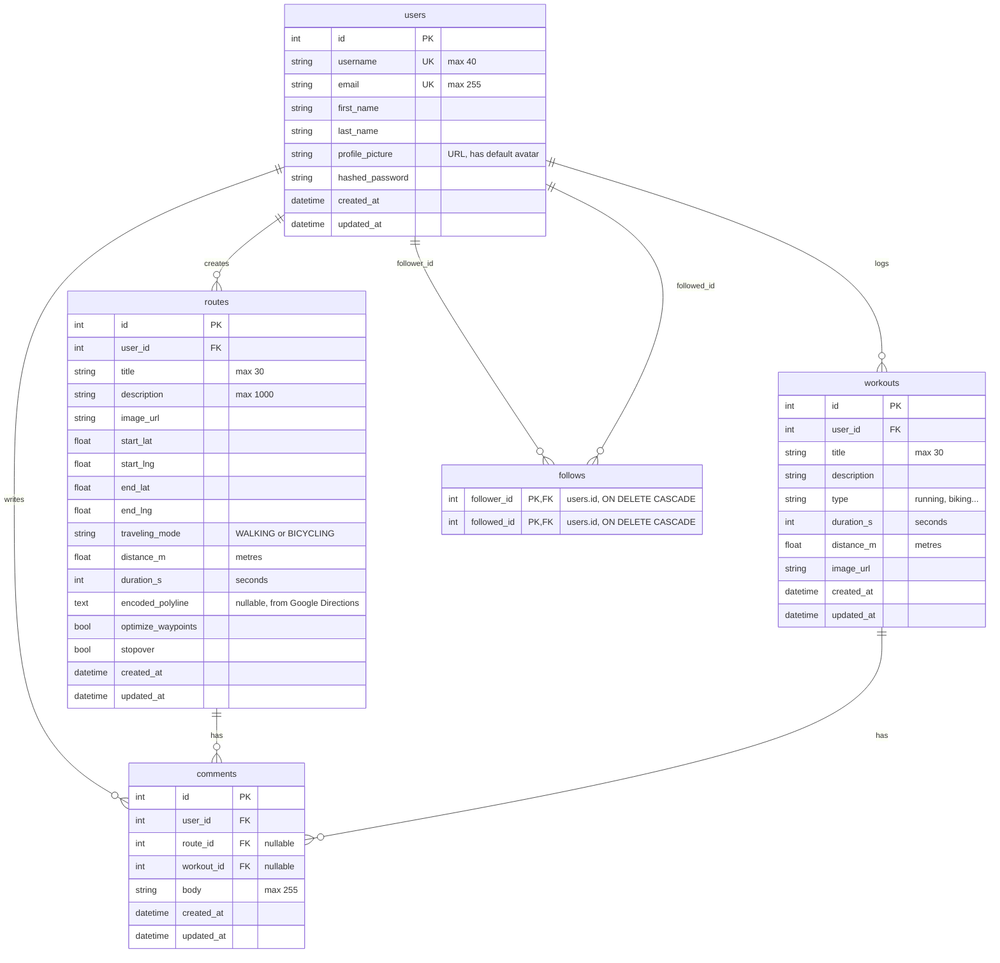
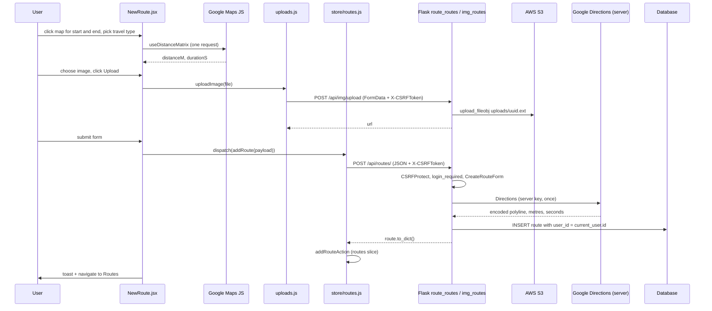

# Aktiv - Guided Code Walkthrough

This is a guided tour of the Aktiv codebase (a fitness route and workout app, originally a Strava-style capstone) as it is **right now on the `modernize` branch**, after Batch 1 (security and bug fixes, A1-A15), Batch 2 (safe seeding and the modern stack, A0 and A16-A23) and Batch 3 (performance and UI/UX, A24-A36 plus Y1-Y5) in `CHANGES.md`. Use it to get your bearings again, to debug the app, and to prepare for interview questions about it.

Read it top to bottom once. After that, use sections 8 (traces) and 9 (debugging cheat sheet) as a reference.

## Table of contents

1. [The app in one minute](#1-the-app-in-one-minute)
2. [Folder map](#2-folder-map)
3. [How to run it locally](#3-how-to-run-it-locally)
4. [Data model](#4-data-model)
5. [Backend tour](#5-backend-tour)
6. [Authentication and security flow](#6-authentication-and-security-flow)
7. [Frontend tour](#7-frontend-tour)
8. [Three end-to-end traces](#8-three-end-to-end-traces)
9. [Where do I look when...](#9-where-do-i-look-when)
10. [What changed in Batches 1 to 3 and what is coming](#10-what-changed-in-batches-1-to-3-and-what-is-coming)
11. [Interview prep](#11-interview-prep)
12. [Glossary](#12-glossary)

---

## 1. The app in one minute

**What it does.** Aktiv lets people sign up, drop a start and end point on a Google Map to save a **route** (walking or cycling), log a **workout** (type, time, distance, photo), comment on routes and workouts, add other users as **friends**, and see an **activity feed** of their friends' routes and workouts. A public demo account (`demo@aa.io` / `password`) lets anyone try it.

**The stack.**

| Layer | Technology | Where |
|---|---|---|
| Frontend | React 19, React Router 7, Redux Toolkit 2 (react-redux 9), built with Vite 8; own design system in `src/styles/` (Bricolage Grotesque + Figtree fonts, CSS variables, light/dark) | `react-app/` |
| Maps | Google Maps JavaScript API via `@react-google-maps/api` 2.20, loaded on demand by `context/GoogleMaps.jsx` (Advanced Markers via `ui/MapMarker.jsx`); Directions from the server (`app/services/directions.py`) | map components in `react-app/src/components/` |
| Backend | Python 3.12, Flask 3.1 (app factory `create_app()`), Flask-SQLAlchemy 3.1 (SQLAlchemy 2.0), Flask-Login 0.6, Flask-WTF 1.3, Flask-Migrate 4 (Alembic 1.20) | `app/` |
| Database | SQLite locally (`app/dev.db`), Postgres in production | `migrations/` |
| File storage | AWS S3 via boto3 (image uploads) | `app/s3_helpers.py` |

**How a request flows.** Every user action follows the same path: a React component calls `dispatch(someThunk())`; the thunk (in `react-app/src/store/*.js`) calls `fetch` / `csrfFetch` on a `/api/...` URL; Flask routes the URL to a function in a **blueprint** (`app/api/*.py`); that function uses a **form** to validate input and a **SQLAlchemy model** to read or write the database; it returns JSON; the thunk dispatches an action; the **slice reducer** (Redux Toolkit `createSlice`) updates the Redux store; components re-render.


Note who talks to Google. The **browser** loads the Maps JavaScript API (drawing maps and pins, and one Distance Matrix request while you place points). **Flask** asks the Directions web service once, when a route is created or edited, and stores the result (encoded polyline, distance in metres, time in seconds) on the route. That needs a second, server-only key (`GOOGLE_MAPS_SERVER_KEY`); without it routes still work and the pages draw a straight line (section 7.5).

---

## 2. Folder map

Skipped: `node_modules/`, `react-app/dist/`, virtualenvs, lockfiles. CSS: shared styles are in `react-app/src/styles/`; page-specific CSS sits next to its component.

```text
Strava-Capstone-Clone/
├── .env.example              # Template for backend env vars (copy to .env)
├── .flaskenv                 # FLASK_APP=app, FLASK_DEBUG=1 (read by `flask` CLI)
├── .python-version           # 3.12 (for pyenv / uv)
├── CHANGES.md                # What Batches 1-3 changed, deviations, open questions and how to verify each item
├── MODERNIZATION_PLAN.md     # All 58 planned improvements (A1-A58)
├── scripts/generate_seed_images.py # Draws the SVG seed/default images (A36)
├── requirements.txt          # The one list of Python runtime dependencies (all pinned)
├── requirements-dev.txt      # autopep8 etc.
├── app/
│   ├── __init__.py           # create_app(): config, extensions, blueprints, CSRF cookie, React serving
│   ├── extensions.py         # login, migrate, csrf (created without an app; db re-exported)
│   ├── config.py             # APP_ENV + Development/Testing/Production config classes
│   ├── s3_helpers.py         # Image validation + shrinking (Pillow) and S3 upload (boto3)
│   ├── services/directions.py# Server-side Google Directions + `flask directions backfill`
│   ├── dev.db                # Local SQLite database (git-ignored, created by you)
│   ├── api/                  # Blueprints = groups of API endpoints
│   │   ├── auth_routes.py    # /api/auth: session restore, login, logout, signup, profile picture
│   │   ├── route_routes.py   # /api/routes: route CRUD + route comments (list is optionally paged)
│   │   ├── workout_routes.py # /api/workouts: workout CRUD + workout comments (get + add)
│   │   ├── comments_routes.py# /api/comments: read/edit/delete any comment by id
│   │   ├── user_routes.py    # /api/users: users, their data, add/remove friend
│   │   ├── me_routes.py      # /api/me/friends/activity: the feed (cursor paged, scope=friends|all)
│   │   ├── pagination.py     # Cursor (keyset) pagination helpers
│   │   └── img_routes.py     # /api/img/upload: image upload to S3
│   ├── forms/                # Flask-WTF forms = server-side validation
│   │   ├── login_form.py, signup_form.py, route_form.py, workout_form.py, comment_form.py, fields.py
│   ├── models/               # SQLAlchemy models = database tables
│   │   ├── db.py             # db object, environment, SCHEMA, add_prefix_for_prod(), utcnow()
│   │   ├── user.py           # User + the `follows` association table
│   │   ├── route.py, workout.py, comment.py
│   └── seeds/                # `flask seed all [--reset]` / `flask seed undo` demo data
│       ├── __init__.py       # The CLI group: seeds only an empty DB; --reset/undo refused in production
│       ├── users.py, routes.py, workouts.py, comments.py
├── migrations/               # Alembic (Flask-Migrate)
│   ├── env.py                # Creates/uses the Postgres SCHEMA in production
│   └── versions/
│       ├── 0a0f8863271d_.py               # Initial schema (2022)
│       ├── b7c1e9a4d2f3_reconcile_models.py # A15: follows PK, drop workouts.route_id, timestamp defaults
│       ├── c4a1f7e2b9d8_add_indexes.py      # A26: indexes on foreign keys and created_at
│       ├── d5e8b3a6c1f2_numeric_distance_duration.py # A31: distance_m / duration_s numbers
│       ├── e6f9c4b7d2a3_route_polyline.py   # A28: routes.encoded_polyline
│       └── f7a0d5c8e3b4_own_default_images.py # A36: old third-party image URLs -> local SVGs
└── react-app/
    ├── package.json          # Dependencies + scripts (dev/start = vite, build = vite build)
    ├── vite.config.js        # Dev server on :3000, /api proxy to Flask :5000, build -> dist/
    ├── index.html            # The single HTML page (Vite entry, loads /src/main.jsx)
    ├── .env.example          # VITE_GOOGLE_MAPS_API_KEY and VITE_GOOGLE_MAPS_MAP_ID template
    ├── eslint.config.js      # jsx-a11y + hooks lint rules (`npm run lint`)
    ├── public/               # favicon + generated SVG images (default avatar, seed art), copied as-is into dist/
    └── src/
        ├── main.jsx          # Entry: store, then Provider > GoogleMapsProvider > UnitsProvider > ToastProvider > ModalProvider > <App/>
        ├── App.jsx           # Session restore, skip link, <main>, lazy-loaded pages behind Suspense + ErrorBoundary, all URL routes (React Router 7)
        ├── config.js         # GOOGLE_MAPS_API_KEY and GOOGLE_MAPS_MAP_ID (import.meta.env, baked in at build time)
        ├── theme.js          # Colours JavaScript needs for Google Maps lines (mirror of the CSS tokens)
        ├── styles/           # tokens.css (palette, type scale, spacing, light/dark), base.css, components.css (buttons, forms, cards, stats, skeletons)
        ├── hooks/            # useDirections.js (distance matrix + fallback directions), usePageTitle.js
        ├── utils/            # format.js (dates, distance, pace), polyline.js (decode + project to SVG)
        ├── context/
        │   ├── Modal.jsx     # Accessible dialog (portal, focus trap, Escape, focus return)
        │   ├── GoogleMaps.jsx + MapsLoader.jsx # Loads the Maps JS API on demand, once; useGoogleMaps() hook
        │   ├── Units.jsx     # km / mi preference (localStorage) and formatters
        │   └── Toast.jsx     # Small confirmation messages (aria-live)
        ├── store/            # Redux Toolkit: one createSlice per file + the thunks that call the API
        │   ├── index.js      # configureStore (thunk + dev checks, logger in dev)
        │   ├── csrf.js       # csrfFetch(): fetch + X-CSRFToken header
        │   ├── session.js, routes.js, workouts.js, comments.js,
        │   ├── users.js, friendsActivity.js, uploads.js   # (no friends slice any more: Y3)
        └── components/       # .jsx files (Vite only parses JSX in .jsx files)
            ├── NavBar.jsx, Footer.jsx, NotFound.jsx, RouteFocus.jsx, ErrorBoundary.jsx
            ├── ui/                # Shared pieces: Logo, Avatar, StatStrip, ActivityCard, ConfirmForm, MapMarker, ContourBackdrop (+ Detail.css, Forms.css)
            ├── auth/              # LoginForm, SignUpForm, LogoutButton, ProtectedRoute (layout route)
            ├── HomePage/ + Map/   # Home page: full-height map with one pin per route + floating "Explore routes" card
            ├── NewMap/NewRoute.jsx # Create a route by clicking the map
            ├── RouteDisplay/      # One route: stored path on a map + stats + comments
            ├── RouteSketch/       # SVG drawing of a route from its stored polyline (no Google call)
            ├── MapAdjustment/     # Edit/delete route modals (EditMapForm has its own map)
            ├── NewWorkout/        # Log a workout form
            ├── WorkoutDisplay/    # One workout + edit/delete modals
            ├── ActivityFeed/      # Feed of friends' (or everyone's) routes + workouts, "Load more"
            ├── Comments/, AddCommentForm/, AddCommentModal/, EditComment/, EditCommentForm/
            ├── User.jsx, UserProfile.css, AdjustFriendStatus/  # Profile page + add/remove friend
            ├── ImageUploadComponenet/        # (sic - typo in folder name) file picker + upload
            ├── UsersList.jsx (People), UserRoutes/Routes.jsx (Routes)  # Card grids, linked from the navbar
```

---

## 3. How to run it locally

You need **two terminals**: one for Flask (port 5000), one for the Vite dev server (port 3000). You use the app at `http://localhost:3000`.

### Backend (terminal 1)

1. **Python 3.12.** All pins in `requirements.txt` are tested on Python 3.12 (`.python-version` says so). Install it with `pyenv install 3.12`, `brew install python@3.12`, or `uv python install 3.12`.
2. **Create and activate a virtualenv** in the project root (`.venv` is git-ignored):
   ```bash
   python3.12 -m venv .venv
   source .venv/bin/activate        # Windows: .venv\Scripts\activate
   ```
3. **Install dependencies** (one file for the app, one for dev tools; there is no Pipfile any more):
   ```bash
   pip install -r requirements.txt -r requirements-dev.txt
   ```
   The Postgres driver is `psycopg2-binary` (prebuilt), so no compiler or `pg_config` is needed.
4. **Create `.env`** from the template and fill it in:
   ```bash
   cp .env.example .env
   python -c "import secrets; print(secrets.token_hex(32))"   # paste as SECRET_KEY
   ```
   The important variables:

   | Variable | Example | What reads it |
   |---|---|---|
   | `APP_ENV` | `development` | `app/config.py` `get_app_env()`; `create_app()` uses it to pick the config class. (`FLASK_ENV` still works as a fallback.) |
   | `SECRET_KEY` | 64 hex chars | Signs the session cookie and CSRF token. Placeholder = warning in dev, crash in production (`check_secret_key()`). |
   | `DATABASE_URL` | `sqlite:///dev.db` | `get_database_url()`. `create_app()` turns the relative SQLite path into `app/dev.db` (Flask-SQLAlchemy 3 would otherwise use `instance/`). Missing = clear `RuntimeError` at startup. |
   | `SCHEMA` | `flask_schema` | Only used when `APP_ENV=production` (Postgres schema on Render). |
   | `S3_BUCKET`, `AWS_REGION` | `my-bucket`, `us-west-2` | `app/s3_helpers.py`. Credentials come from `~/.aws` or `AWS_ACCESS_KEY_ID`/`AWS_SECRET_ACCESS_KEY`, not from `.env` keys named `S3_KEY`. Only needed to test uploads. |
   | `SQLALCHEMY_ECHO` | `0` | Optional: silences the SQL log in development. |
   | `GOOGLE_MAPS_SERVER_KEY` | `AIza...` | Optional (A28). A **separate** Google key with only the *Directions API* enabled, restricted by IP, never sent to the browser. With it, creating or editing a route stores the real path, distance and time; without it routes still save (straight-line fallback). `flask directions backfill` fills in routes saved before the key existed. |

   The `flask` command loads `.flaskenv` and `.env` automatically (python-dotenv). `FLASK_APP=app` points at the `app` package, and Flask finds its `create_app()` factory by itself.
5. **Build the database** (this runs the Alembic migrations in `migrations/versions/`):
   ```bash
   flask db upgrade
   ```
   Do **not** run `flask db migrate` as part of setup. `migrate` *generates a new migration file* by comparing models to the DB; you only run it when you change a model. If you have an older `app/dev.db`, back it up first (`cp app/dev.db app/dev.db.bak`).
6. **Seed demo data:**
   ```bash
   flask seed all             # seeds only if the database has no users
   flask seed all --reset     # local only: delete everything, then seed again
   ```
   `flask seed all` is safe to run any number of times: on a database that already has users it prints `Database already has data. Skipping seed.` and changes nothing. `--reset` (and `flask seed undo`) delete all rows and refuse to run with `APP_ENV=production`.
7. **Start Flask:**
   ```bash
   flask run        # http://localhost:5000, debugger + auto-reload from FLASK_DEBUG=1
   ```
   Production uses gunicorn with the factory: `gunicorn "app:create_app()"` (never `flask run`).

### Frontend (terminal 2)

1. **Node 20.19+ or 22.12+** (Vite 8's requirement; `package.json` `engines`).
2. Maps key: copy `react-app/.env.example` to `react-app/.env.local` and set `VITE_GOOGLE_MAPS_API_KEY=...` (a browser key restricted to `http://localhost:3000/*`; see A12 in `CHANGES.md`). It used to be `REACT_APP_GOOGLE_MAPS_API_KEY`; rename it if you have an old `.env.local`. Without it the app works but maps show nothing and the console warns `VITE_GOOGLE_MAPS_API_KEY is not set`.
   Optional: set `VITE_GOOGLE_MAPS_MAP_ID=...` (Google Cloud Console > Map Management). Pins use Advanced Markers, which need a Map ID; without one the app falls back to Google's shared `DEMO_MAP_ID` (fine for development, not for production).
3. Install and start:
   ```bash
   cd react-app
   npm ci               # exact versions from package-lock.json
   npm run dev          # (npm start does the same) -> http://localhost:3000
   ```
4. Open `http://localhost:3000` and click **Try the demo account** (or log in with `demo@aa.io` / `password`).
5. Optional checks: `npm run lint` (accessibility and hook rules, expect no output) and `npm run build`.

Production build: `npm run build` writes `react-app/dist/`; then `flask run` (or gunicorn) alone serves the whole app at `http://localhost:5000`. `npm run preview` serves `dist/` with Vite for a quick look.

### Why two ports work: the Vite proxy

`react-app/vite.config.js` has `server.proxy: { '/api': 'http://localhost:5000' }`. The Vite dev server on port 3000 serves the React code itself and forwards every `/api/...` request to Flask on port 5000. To the browser, everything comes from `localhost:3000`, so cookies are first-party and **no CORS is needed** (which is why A10 could delete Flask-Cors). (Create React App did the same with a `"proxy"` field in `package.json` before A19.)

In production there is only one server: Flask serves the built React files from `react-app/dist` (see `react_root` in section 5) plus the API on the same domain.

---
## 4. Data model

Five tables: four model classes plus the `follows` association table.



Things to notice:

- **Workouts are not linked to routes.** A15 dropped the unused `workouts.route_id` column. A workout is just a log entry.
- **A comment belongs to either a route or a workout** (one of `route_id` / `workout_id` is set). Nothing in the database enforces "exactly one".
- **Distance and time are numbers** (A31): `distance_m` in metres and `duration_s` in seconds, on both routes and workouts. The old text (`"16.2 km"`, `"1 hr 20 min"`) was parsed into numbers by the migration; the browser formats them as km or miles, `1:20:00`, pace and speed (`utils/format.js`).
- **Indexes** (A26): every foreign key (`user_id`, `route_id`, `workout_id`, both `follows` columns) and `created_at` on routes, workouts and comments, so the feed, the lists and comment counts do not scan whole tables.
- **Friendship = two `follows` rows**, one per direction. The add-friend endpoint writes both.

### Notes per model file

- **`app/models/db.py`** - Also holds `iso()` (timestamps as ISO 8601 UTC strings with a `Z`). Creates the single `db = SQLAlchemy()` object that every model imports. Also defines `utcnow()` (the Python default for every `created_at`/`updated_at`: the current UTC time, stored without tzinfo because the columns are plain `DateTime`), `environment` (from `get_app_env()`), `SCHEMA` (env var) and `add_prefix_for_prod("users.id")`, which turns foreign key targets into `flask_schema.users.id` in production. This is the "Render pattern": production tables live in a named Postgres schema. A47 plans to remove it.
- **`app/models/__init__.py`** - Re-exports `db`, `User`, `Route`, `Comment`, `Workout` so other code can write `from app.models import User, db`.
- **`app/models/user.py`** - `User(db.Model, UserMixin)`. Three serializers (A24): `to_summary()` (id, names, picture; used wherever an owner is shown, **no email**), `to_friend()` (summary plus `userId`) and `to_dict(private, include_activity)` for profiles. `UserMixin` gives Flask-Login the `is_authenticated` / `get_id()` methods it needs. The `password` property setter hashes with Werkzeug's `generate_password_hash`; `check_password()` verifies. The self-referencing `followers` relationship goes through `follows`: `user.followers` = the users who have a row "follower -> user". `to_dict()` is now small: the user's own fields, counts and friends; the full lists of routes and workouts are only included for one profile (`include_activity=True`). Before A24 it nested every route, workout and comment, which made `/api/auth/` about 27 KB / 34 queries and `/api/users/` 68 KB / 65 queries; they are now about 1 KB / 5 and 1 KB / 2.
- **`app/models/route.py`** - `Route`. `EDITABLE_FIELDS` + `set_kwargs()` (added in A3) make sure an update can only touch whitelisted columns, never `user_id`. `to_dict(polyline=True)` reshapes columns for the frontend: `startingPoint`/`endingPoint` objects, `travelMode`, `distanceM`, `durationS`, `commentCount` (a correlated subquery `column_property`, so no comment rows are loaded) and `ownerInfo` (a user summary, no email). The encoded `polyline` is included for one route and the feed, and left out of the all-routes list (`polyline=False`) to keep it small. Owners are loaded with `joinedload`, so a list of N routes is 2 queries, not N+1 (A25).
- **`app/models/workout.py`** - `Workout`, same pattern as `Route` (`EDITABLE_FIELDS`, `set_kwargs()`, `to_dict()` with `distanceM`, `durationS`, `commentCount`, `ownerInfo`).
- **`app/models/comment.py`** - `Comment`. `to_dict()` returns `id`, `userId`, `body`, `createdAt`, the parent id (`routeId` or `workoutId`) and a small `user` object (`username`, `profilePicture`).

Relationship names are plural even when they point to one object (`comment.users`, `route.users`). That is a naming quirk from 2023, not a many-to-many.

---

## 5. Backend tour

### 5.1 `app/__init__.py` and `app/extensions.py`, step by step

Since A16 the app is built by an **application factory**: `create_app(config_name=None)` creates a *new* Flask app each time it is called. Nothing is created at import time, so tests can build an app with their own settings (`create_app('testing')`), and `flask` / gunicorn call the factory for you (`FLASK_APP=app`, `gunicorn "app:create_app()"`).

**`app/extensions.py`** creates the extensions *without* an app: `login = LoginManager()` (with `login.login_view = 'auth.unauthorized'`), `migrate = Migrate()`, `csrf = CSRFProtect()`, and re-exports `db` from `app/models/db.py`. Any module can import them without importing the app.

**`create_app()`**, in order:

1. **Creates the app:** `Flask(__name__, static_folder='../react-app/dist', static_url_path='/')`. The static folder is the **React production build** (`npm run build`). That is how one Flask process serves both the API and the frontend in production.
2. **Config:** `app.config.from_object(get_config(config_name))` picks `DevelopmentConfig`, `TestingConfig` or `ProductionConfig` from `app/config.py` (`config_name` defaults to `APP_ENV`). Then `check_secret_key()` (crashes in production on a missing/placeholder key) and a check that `SQLALCHEMY_DATABASE_URI` is set. A relative SQLite URL is made absolute under `app/` so `sqlite:///dev.db` keeps meaning `app/dev.db`.
3. **Extensions:** `db.init_app(app)` connects SQLAlchemy; `migrate.init_app(app, db)` adds the `flask db ...` commands; `login.init_app(app)`; `csrf.init_app(app)` makes **every** POST/PUT/PATCH/DELETE require a valid `X-CSRFToken` header.
4. **Seed commands:** `app.cli.add_command(seed_commands)` registers `flask seed all [--reset]` and `flask seed undo`.
5. **Blueprints:** seven `register_blueprint` calls mount each `app/api/*.py` file under its URL prefix (`/api/users`, `/api/auth`, `/api/routes`, `/api/workouts`, `/api/comments`, `/api/img`, `/api/me`).
6. **`register_hooks(app)`** adds **`inject_csrf_token`** (`@app.after_request`): on **every** response, sets a `csrf_token` cookie containing `generate_csrf()`. It is deliberately **not** HttpOnly so JavaScript can read it. Details in section 6.
7. **`register_app_routes(app)`** adds:
   - **`/api/docs`** (`api_help`): lists every URL rule and its docstring. Disabled (404) in production unless `ENABLE_API_DOCS=1`. Handy locally: open `http://localhost:5000/api/docs`.
   - **`react_root`**: the catch-all `GET /` and `GET /<path:path>`. It returns `index.html` from the React build for any path no other rule matched, so that React Router can handle URLs like `/routes/5` after a browser refresh. `/favicon.ico` uses `flask.send_from_directory(app.static_folder, ...)` (the old `app.send_from_directory` call never existed; fixed in A17).
8. **`register_error_handlers(app)`**: CSRF failures become JSON 400 `{"errors": ["CSRF token missing or invalid. ..."]}`; 413 (upload too large) returns JSON `{"errors": "File is too large (max 5 MB)"}`; 404 returns `index.html`.

**`load_user(id)`** (`@login.user_loader`, module level): on each request, Flask-Login reads the user id from the signed session cookie and calls this to get the `User` row with `db.session.get(User, int(id))`. That object becomes `current_user`. When a `@login_required` view is hit without a session, Flask-Login **redirects (302)** to `/api/auth/unauthorized`, which returns `{"errors": ["Unauthorized"]}` with 401. `fetch` follows the redirect, so the frontend sees a 401.

The config classes in **`app/config.py`**: `Config` holds shared settings (cookie flags `HttpOnly`/`SameSite=Lax`, `MAX_CONTENT_LENGTH = 5 MB`, `WTF_CSRF_TIME_LIMIT = None`, `pool_pre_ping`). `DevelopmentConfig` turns SQL echo on. `TestingConfig` uses in-memory SQLite. `ProductionConfig` sets `Secure` cookies and turns `/api/docs` off. `get_config()` raises a clear error for an unknown `APP_ENV`. (The classes read environment variables when `config.py` is first imported.)

### 5.2 Forms (`app/forms/`)

Flask-WTF forms do **server-side validation**. Even though the frontend sends JSON, `FlaskForm()` reads `request.get_json()` automatically, so `form.validate_on_submit()` works. With global `CSRFProtect`, the form's own CSRF check is skipped for requests that already passed it.

| Form | Fields and rules | Used by |
|---|---|---|
| `LoginForm` | `email`, `password` (required, max 255). The actual email/password check is in the view so both failures return the same message (A9). | `auth_routes.login` |
| `SignUpForm` | `username` (max 40, `username_exists`), `email` (`Email()`, `user_exists`), `password` (min 8), optional `profile_picture`, `first_name`, `last_name` | `auth_routes.sign_up` |
| `CreateRouteForm` | `title` (30), `description` (1000), `start_lat/lng`, `end_lat/lng`, `traveling_mode` (`WALKING` or `BICYCLING`), `distance_m`, `duration_s` (optional), `image_url` | add and update route |
| `CreateWorkoutForm` | `title`, `description`, `type`, `duration_s`, `distance_m` (numbers, validated as positive), `image_url` | add and update workout |
| `CreateCommentForm` | `body` (required, max 255) | all comment create/edit |

Each blueprint has its own copy of `validation_errors_to_error_messages()`, which flattens `form.errors` into strings like `"title : Field cannot be longer than 30 characters."`.

`app/forms/fields.py` has `SafeFloatField` / `SafeIntegerField`, which turn a JSON `null` or junk into a normal validation error instead of a 500.

Gotcha: `FloatField` + `DataRequired` rejects `0.0`, so a point exactly on the equator or the prime meridian would fail validation. Not a real-world problem for this app, but a good "spot the bug" talking point.

### 5.3 Every API endpoint

All responses are JSON. "Login" = `@login_required` (401 via redirect if not logged in). "Owner" = returns 403 if the record belongs to someone else. All write methods also need the `X-CSRFToken` header. Error bodies are `{"errors": [...]}` unless noted.

| Method | Path | Login | Owner | Handler | Models | Success response |
|---|---|---|---|---|---|---|
| GET | `/api/auth/` | no | - | `auth_routes.authenticate` | User | Slim user (`to_dict(private=True)`: own fields, counts, `friends`) + `nonFriends` (summaries). **Logged out: 200 with `{"errors": ["Unauthorized"]}`** (not 401). |
| POST | `/api/auth/login` | no | - | `auth_routes.login` | User | Same as above. Bad credentials: 401 `Invalid email or password`. |
| POST | `/api/auth/logout` | no | - | `auth_routes.logout` | - | `{"message": "User logged out"}`. **POST with the CSRF header since Y4** (a GET can no longer log you out). |
| POST | `/api/auth/signup` | no | - | `auth_routes.sign_up` | User | Slim user; logs the new user in. 400 on validation errors. |
| PUT | `/api/auth/profile-picture` | yes | self | `auth_routes.set_profile_picture` | User | `{"profilePicture": url}`. Only accepts URLs under your bucket's `uploads/`. |
| GET | `/api/auth/unauthorized` | no | - | `auth_routes.unauthorized` | - | 401 `{"errors": ["Unauthorized"]}` (Flask-Login redirect target) |
| GET | `/api/routes/` | yes | - | `route_routes.all_routes` | Route, User | `{"routes": [...], "nextCursor": null or "..."}`. Without `?limit=` it returns everything (the home map needs every pin); with `?limit=N&cursor=...` it pages newest first. Items have no polyline. |
| POST | `/api/routes/` | yes | - | `route_routes.add_route` | Route | The new route `to_dict()`. `user_id` comes from `current_user`. Asks Google Directions once (if `GOOGLE_MAPS_SERVER_KEY` is set) and stores polyline, distance and time. |
| GET | `/api/routes/<id>` | yes | - | `route_routes.one_route` | Route | route `to_dict()` incl. `polyline`, 404 if missing |
| PUT | `/api/routes/<id>` | yes | yes | `route_routes.update_route` | Route | updated route (path is recomputed if the points or mode changed) |
| DELETE | `/api/routes/<id>` | yes | yes | `route_routes.delete_route` | Route (+ its comments via cascade) | `{"message": "Success"}` |
| GET | `/api/routes/<id>/comments` | yes | - | `route_routes.get_comments_to_route` | Route, Comment | `{"comments": [...]}` |
| POST | `/api/routes/<id>/comments` | yes | - | `route_routes.add_comment_to_route` | Comment | new comment `to_dict()` |
| GET | `/api/workouts/` | yes | - | `workout_routes.all_workouts` | Workout | `{"workouts": [...], "nextCursor": ...}`, optional paging like routes |
| POST | `/api/workouts/` | yes | - | `workout_routes.add_workout` | Workout | new workout `to_dict()` |
| GET | `/api/workouts/<id>` | yes | - | `workout_routes.one_workout` | Workout | workout `to_dict()` |
| PUT | `/api/workouts/<id>` | yes | yes | `workout_routes.update_workout` | Workout | updated workout |
| DELETE | `/api/workouts/<id>` | yes | yes | `workout_routes.delete_workout` | Workout | `{"message": "Success"}` |
| GET | `/api/workouts/<id>/comments` | yes | - | `workout_routes.get_comments_to_workout` | Workout, Comment | `{"comments": [...]}` (added in Y1) |
| POST | `/api/workouts/<id>/comments` | yes | - | `workout_routes.add_comment_to_workout` | Comment | new comment |
| GET | `/api/comments/` | yes | - | `comments_routes.all_comments` | Comment | `{"comments": [...]}` |
| GET | `/api/comments/<id>` | yes | - | `comments_routes.one_comment` | Comment | comment `to_dict()` |
| PUT | `/api/comments/<id>` | yes | yes | `comments_routes.update_comment` | Comment | updated comment |
| DELETE | `/api/comments/<id>` | yes | yes | `comments_routes.delete_comment` | Comment | `{"message": "Success"}` |
| GET | `/api/users/` | yes | - | `user_routes.users` | User | `{"users": [summary, ...]}` (names and pictures only; no emails, no nested data) |
| GET | `/api/users/<id>` | yes | - | `user_routes.user` | User | profile: user fields, `routes`, `workouts` (with `commentCount`), `friends` |
| GET | `/api/users/<id>/routes` | yes | - | `user_routes.user_route` | User, Route | `{"routes": [...]}` |
| GET | `/api/users/<id>/comments` | yes | - | `user_routes.user_comments` | User, Comment | `{"comments": [...]}` |
| GET | `/api/users/<id>/workouts` | yes | - | `user_routes.user_workouts` | User, Workout | `{"workouts": [...]}` |
| GET | `/api/users/<id>/friends` | yes | - | `user_routes.user_friends` | User, follows | `{"friends": [{id, userId, username, firstName, lastName, profilePicture}]}` |
| POST | `/api/users/<id>/friends` | yes | - | `user_routes.add_user_friends` | User, follows | `{"friend": user, "currUser": user}`. 400 self, 404 missing, 409 already friends. |
| DELETE | `/api/users/<id>/friends` | yes | - | `user_routes.unfriend_user` | User, follows | `{"unFriended": user, "currUser": [friends]}` |
| GET | `/api/me/friends/activity` | yes | - | `me_routes.friend_activity` | User, Route, Workout | `{"items": [...], "nextCursor": ...}`: routes and workouts merged newest first, each with `kind` (`route` or `workout`). `?scope=friends` (default) or `all`, `?limit=` (default 20, max 50), `?cursor=`. 4 queries however long the feed is. |
| POST | `/api/img/upload` | yes | - | `img_routes.upload_image` | - (S3) | `{"url": "https://<bucket>.s3.amazonaws.com/uploads/<uuid>.<ext>"}`. Large images are shrunk to at most 1600 px first. Errors here are a **string**: `{"errors": "file is not a valid image"}`. |
| GET | `/api/docs` | no | - | `__init__.api_help` | - | Map of URL -> [methods, docstring]. 404 in production. |
| GET | any other path | no | - | `__init__.react_root` | - | React `index.html` (HTML is `no-cache`; files under `/assets/` are cached for a year because their names contain a hash) |

**Owner checks** follow the same shape everywhere (see `update_route` in `app/api/route_routes.py`): load with `db.session.get(Model, id)` -> `None` returns 404 -> `record.user_id != current_user.id` returns 403 -> only then validate the form and save.

### 5.3a SQLAlchemy 2.0 query patterns (A18)

The code uses the SQLAlchemy 2.0 style everywhere; `Model.query...` (the 1.x "legacy" API) is gone from the app code. The four patterns you will see:

| You want | 2.0 style used here | Old 1.x style (do not use) |
|---|---|---|
| One row by primary key | `db.session.get(Route, id)` (returns `None` if missing) | `Route.query.get(id)` |
| All rows | `db.session.scalars(db.select(Route)).all()` | `Route.query.all()` |
| First row matching a condition | `db.session.scalar(db.select(User).where(User.email == email))` | `User.query.filter(...).first()` |
| Filtered + ordered list | `db.session.scalars(db.select(Route).where(Route.user_id == uid).order_by(Route.created_at.desc())).all()` | `Route.query.filter(...).order_by(...).all()` |

`db.select(...)` builds a `SELECT` statement; `session.scalars(stmt)` runs it and returns model objects (`.all()` = list); `session.scalar(stmt)` returns the first object or `None`. Raw SQL must be wrapped in `text("...")` (a plain string passed to `execute()` is an error in 2.0); the seeds use `select()`/`delete()` instead. The friends relationship (`user.followers`) is still a `lazy='dynamic'` relationship, which works in 2.0. Models still use the classic `db.Column(...)` style (typed `Mapped[...]` columns are optional and were not adopted).

### 5.4 `app/s3_helpers.py`

The upload pipeline used by `img_routes.upload_image`. A30 adds `shrink_image()`: after validation, photos wider or taller than 1600 px are resized (with the camera rotation applied) and re-encoded, so a 6 MB phone photo does not get served to every feed card; GIFs are left alone.

1. `allowed_file(filename)` - extension must be png/jpg/jpeg/gif/webp.
2. `detect_image(file)` - opens the bytes with **Pillow** and calls `verify()`. Returns `(ext, content_type)` from what Pillow detected, so a renamed `.html` file is rejected and the stored `Content-Type` cannot be faked.
3. `get_unique_filename()` - `uploads/<uuid4 hex>.<ext>`.
4. `upload_file_to_s3(file, content_type)` - `get_s3_client().upload_fileobj(...)` with no ACL. The boto3 client is created lazily on first use with the **default credential chain** (IAM role on EC2, `~/.aws` locally).
5. Returns `{"url": S3_LOCATION + key}`. `S3_LOCATION` is `S3_PUBLIC_URL` or `https://<S3_BUCKET>.s3.amazonaws.com/`.

`MAX_CONTENT_LENGTH` (5 MB) is enforced by Flask before your code runs and produces the JSON 413.

For uploaded images to be viewable, the bucket needs a public-read policy on `uploads/*` (see A5 in `CHANGES.md`).

### 5.5 Seeds and migrations

**Seeds** (`app/seeds/`) are the `flask seed` CLI commands (rewritten in A0):

- `flask seed all` -> `seed()` in `app/seeds/__init__.py`. If `database_has_data()` (at least one user) it prints `Database already has data. Skipping seed.` and stops. Otherwise `seed_demo_data()` runs the four seed functions. **Safe to run on every deploy.**
- `flask seed all --reset` and `flask seed undo` -> `delete_all_data()` deletes every row **children before parents** (`comments`, `workouts`, `routes`, `follows`, `users`) with SQLAlchemy `delete()`. Both call `refuse_in_production()` first, which raises `click.ClickException` (exit code 1) when `APP_ENV=production`.
- `seed_users()` creates 5 users (demo, marnie, tammie, bobbie, jimmy, all with password `password`), inserts them in that order and flushes (so a fresh DB gives demo=1 ... jimmy=5), then sets the friendships (`demo.followers = [...]`). It **returns the list of users**.
- `seed_routes(users)` and `seed_workouts(users)` return their objects; `seed_comments(users, routes, workouts)` uses them. Owners are written as `users[2].id`, `routes[19].id`, ... so **no database id is hard-coded**; the seeds work even if ids do not start at 1 (e.g. on Postgres after a `--reset`).
- Seed images are local SVG files in `react-app/public/images/` (drawn by `scripts/generate_seed_images.py`, A36), and the seeded distances and times are realistic numbers. `flask directions backfill [--all]` (A28) fills in stored paths for routes that have none.

> **The seeding rule.** Deploys run `flask db upgrade && flask seed all` (safe every time). Reset only locally with `flask seed all --reset`. Never run `docker compose down -v` on a stack with data you care about (it deletes the database volume). Take a backup (`pg_dump`) before any production migration. Before A0, `flask seed all` in production started with `TRUNCATE ... RESTART IDENTITY CASCADE` on every table, and the old Render deploy ran it on every deploy, wiping real data each time.

**Migrations** (`migrations/`) are managed by Flask-Migrate (a wrapper around Alembic):

- `0a0f8863271d_.py` - the initial schema from 2022 (users, follows, routes, workouts, comments).
- `b7c1e9a4d2f3_reconcile_models.py` - A15: drops `workouts.route_id`, rebuilds `follows` with a composite primary key and `ON DELETE CASCADE` (via a copy-and-rename `follows_new`), and adds database-side `CURRENT_TIMESTAMP` defaults. Has a working `downgrade()`.
- `migrations/env.py` - in production runs `CREATE SCHEMA IF NOT EXISTS {SCHEMA}` (wrapped in `text()` and committed, as SQLAlchemy 2.0 requires) and `SET search_path TO {SCHEMA}` so tables go into the named schema. It hands Alembic the database URL with `url.render_as_string(hide_password=False)` (2.0's `str(url)` hides the password).

Commands: `flask db upgrade` (apply), `flask db downgrade` (undo one), `flask db migrate -m "msg"` (generate a new migration after changing a model; always read the generated file), `flask db current` (where am I).

---
## 6. Authentication and security flow

Aktiv uses **cookie sessions**, not JWTs. Two cookies matter:

| Cookie | Set by | HttpOnly? | Purpose |
|---|---|---|---|
| `session` | Flask (signed with `SECRET_KEY`) | yes | Holds Flask-Login's user id (`_user_id`) and the raw CSRF token. JavaScript cannot read it. |
| `csrf_token` | `inject_csrf_token` in `app/__init__.py` on every response | **no** | A signed copy of the CSRF token that the frontend reads and echoes back in the `X-CSRFToken` header. |

Both use `SameSite=Lax` and become `Secure` (HTTPS only) when `APP_ENV=production`.

### Why the CSRF header works

A malicious site can make your browser *send* cookies to Aktiv, but it cannot *read* them (same-origin policy). Flask-WTF's `CSRFProtect` compares the `X-CSRFToken` header against the token stored inside the signed `session`. Only JavaScript running on Aktiv's own origin can read `csrf_token` and put it in the header, so forged requests fail with 400. `react-app/src/store/csrf.js` does this in `csrfFetch()`: for any method other than GET/HEAD/OPTIONS/TRACE, it reads the cookie with `getCsrfToken()` and adds the header.

(Before A6, every view copied the cookie into the form and compared it with... the same cookie, which protected nothing.)

### Step by step

**Restore session (every page load).** `App.jsx` `useEffect` -> `dispatch(authenticate())` (`store/session.js`) -> `GET /api/auth/` -> `authenticate()` in `auth_routes.py`. If the `session` cookie has a valid user id, Flask-Login's `load_user()` loads the user and the view returns `to_dict()` + `nonFriends`. Otherwise it returns `{"errors": [...]}` and the thunk returns `null`. Either way the response also sets the `csrf_token` cookie, so the browser has a token before the user submits anything.

**Login.** `LoginForm.onLogin` -> `login(email, password)` thunk -> `csrfFetch('POST /api/auth/login')` with the header -> `CSRFProtect` checks the header -> `auth_routes.login()` validates `LoginForm`, finds the user by email, `user.check_password()`, then `login_user(user)` writes the user id into the session -> response sets a new `session` cookie -> thunk dispatches `setUser(data)` -> `state.session.user` is set -> `LoginForm` sees `user` and renders `<Navigate to='/' replace />`.

**Signup.** `SignUpForm.onSignUp` checks passwords match -> `signUp(...)` thunk -> `POST /api/auth/signup` -> `SignUpForm` validators (unique email/username, `Email()`, min 8 chars) -> create `User` (password setter hashes it) -> `login_user` -> returns the user. If a picture was chosen, the component *then* calls `uploadImage()` and `setProfilePicture()` (`PUT /api/auth/profile-picture`) because uploads need a logged-in user, and finally `authenticate()` again to refresh the picture.

**Logout.** `LogoutButton.onLogout` -> `logout()` thunk -> `POST /api/auth/logout` (with the CSRF header, Y4) -> `logout_user()` removes the user id from the session -> thunk dispatches `removeUser()` -> `navigate('/')`.

**Protected pages.** On the backend, `@login_required` guards every data endpoint. On the frontend, `components/auth/ProtectedRoute.jsx` is a **layout route**: it renders the matched page through `<Outlet />` only if `state.session.user` exists, otherwise `<Navigate to='/' replace />`. The frontend check is only for UX; the backend check is the real one.

**Ownership.** Update/delete endpoints compare `record.user_id` with `current_user.id` and return 403 (section 5.3). Create endpoints take `user_id` from `current_user`, ignoring any `user_id` the frontend sends (the frontend does still send it in its payloads; it is harmless). `set_kwargs()` only touches `EDITABLE_FIELDS`.


Other security measures from Batch 1: generic login error plus a dummy hash check for unknown emails (no user enumeration, A9), form length limits (A9), 5 MB upload limit and Pillow verification (A4), no wildcard CORS (A10), `SECRET_KEY` guard (A1). Not done yet: rate limiting on login, logout as POST.

---

## 7. Frontend tour

### 7.1 Entry point

- **`react-app/index.html`** - the one HTML page with `<div id="root">` and `<script type="module" src="/src/main.jsx">`. Vite uses it as the entry point in development and rewrites it into `dist/index.html` (with hashed JS/CSS file names) on `npm run build`.
- **`react-app/src/main.jsx`** - `configureStore()` creates the Redux store, then `createRoot(document.getElementById('root')).render(...)` renders `<App />` inside `<React.StrictMode>`, `<Provider store>` (Redux), `<GoogleMapsProvider>` (loads Google Maps on demand, section 7.5), `<UnitsProvider>` (km or miles, remembered in localStorage), `<ToastProvider>` (confirmation messages) and `<ModalProvider>` (a portal target for dialogs). `index.css` imports the design tokens and the self-hosted fonts.
- **`react-app/src/App.jsx`** - on mount, awaits `authenticate()` and then renders (the old "preload every route and workout" step is gone: every page loads its own data). It renders a skip link, `<NavBar>`, `<RouteFocus>` (moves focus to the page after each navigation), `<main id="main">` containing an `ErrorBoundary` and a `Suspense` around the routes, and `<Footer>`. Pages are `React.lazy` imports, so each page is its own JavaScript file and the first visit downloads only what it needs (A30).

### 7.2 `App.jsx` routes

React Router 7 (package `react-router`), "declarative mode": `<BrowserRouter>` + `<Routes>` (imported as `RouterRoutes`, because the app has its own page component called `Routes`). Each `<Route>` has `path` and `element`; paths match exactly unless they end in `/*`, and the router picks the best match (order does not matter). The protected pages are **children of a layout route** `<Route element={<ProtectedRoute />}>`. `<NavBar />` and `<Footer />` render on every page; each page sets its own browser-tab title with `usePageTitle()` ("Routes | Aktiv").

| URL | Component | Who | What it shows |
|---|---|---|---|
| `/` | `HomePage` or `LoginForm` | anyone | Logged in: full-height map with one pin per route (`Map/MapComponent.jsx`) and a floating "Explore routes" card; click a pin -> info window with link. Logged out: split-screen login with a "Try the demo account" button. |
| `/sign-up` | `SignUpForm` | logged out (logged in -> `<Navigate to='/' replace />`) | Sign-up form with optional picture |
| `/login` | `<Navigate to='/' replace />` | anyone | Kept for old links |
| `/users` | `UsersList` | protected | "People": a grid of everyone with a profile link (navbar: People) |
| `/users/:userId` | `User` | protected | Profile: banner with counts and the add/remove friend button, their routes and workouts as cards, friends list |
| `/routes` | `UserRoutes/Routes` | protected | Grid of every route as cards (navbar: Routes) |
| `/activity` | `ActivityFeed` | protected | Feed of friends' or everyone's routes and workouts (Friends / Everyone switch), "Load more" paging, profile card and suggestions on the sides |
| `/routes/:routeId` | `RouteDisplay` | protected | Map with the stored path, stats, owner, comments; edit/delete if owner; "Route not found" for a bad id |
| `/workouts/:workoutId` | `WorkoutDisplay` | protected | Workout photo, stats (distance, time, pace or speed), comments (Y1); edit/delete if owner |
| `/newRoute` | `NewMap/NewRoute` | protected | Click-to-place map + form to create a route |
| `/newWorkout` | `NewWorkout/NewWorkout` | protected | Form to log a workout |
| `*` (anything else) | `NotFound` | anyone | "Page not found" with a link home |

`NavBar.jsx` links (`<NavLink>`, which marks the current page with `aria-current`) to `/` ("Map"), `/routes` ("Routes"), `/activity` ("Activity"), `/users` ("People"), the buttons `/newRoute` ("+ Route") and `/newWorkout` ("+ Workout"), a km/mi toggle and "Log out" when logged in, and "Log in" / "Sign up" when logged out. Below 900 px the links fold into a menu button (`aria-expanded`, closes on Escape and on navigation). Components navigate in code with `const navigate = useNavigate()` and read URL params with `useParams()`.

### 7.3 Redux store map

The store uses **Redux Toolkit** (A21). `store/index.js` calls Toolkit's `configureStore({ reducer, preloadedState, middleware, devTools })`: the default middleware includes **redux-thunk** (so `dispatch(someThunk())` works) and, in development only, checks that log an error if state is mutated outside a reducer or a non-serializable value is stored; `redux-logger` is added in development (logs every action with before/after state in the browser console), and the Redux DevTools extension is enabled in development.

Each store file has one **`createSlice`** (name, initial state, reducer functions; Toolkit generates the action creators and action types like `routes/getRoutes`) plus the hand-written **thunks** that call the API and dispatch those actions. Reducers are written as "mutations" (`state.routes[id] = route`); **Immer** turns that into a proper immutable update, and Toolkit freezes the state so nothing else can change it by accident.

| State key | File | State shape | Thunks -> endpoint | Slice actions |
|---|---|---|---|---|
| `session` | `session.js` | `{ user: User or null }` (slim user: fields, counts, `friends`, `nonFriends`) | `authenticate` -> GET `/api/auth/`; `login` -> POST `/api/auth/login`; `logout` -> POST `/api/auth/logout`; `signUp` -> POST `/api/auth/signup` | `session/setUser`, `session/removeUser` |
| `routes` | `routes.js` | `{ routes: {id: route} or null, currentRoute: route or null }` | `getAllRoutes` -> GET `/api/routes/`; `getCurrentRoute(id)` -> GET `/api/routes/<id>`; `addRoute` -> POST `/api/routes/`; `updateRoute` -> PUT `/api/routes/<id>`; `deleteRoute` -> DELETE `/api/routes/<id>` | `routes/getRoutes` (also clears `currentRoute`), `getCurrentRouteAction`, `addRouteAction`, `updateRouteAction`, `deleteRouteAction` |
| `workouts` | `workouts.js` | `{ workouts: {id: workout} or null, currentWorkout }` | `getAllWorkouts`, `getCurrentWorkout`, `addWorkout`, `updateWorkout`, `deleteWorkout` -> `/api/workouts/...` | `workouts/getWorkouts`, ... |
| `comments` | `comments.js` | `{ id: comment }` (only the comments of the page you are on) | `getRouteComments` -> GET `/api/routes/<id>/comments`; `getWorkoutComments` -> GET `/api/workouts/<id>/comments`; `newRouteComment` -> POST `/api/routes/<id>/comments`; `newWorkoutComment` -> POST `/api/workouts/<id>/comments`; `updateComment` -> PUT `/api/comments/<id>`; `deleteComment` -> DELETE `/api/comments/<id>` | `comments/getComments`, ... |
| `users` | `users.js` | `{ users: {id: user} or null, currentUser }` | `getAllUsers` -> GET `/api/users/`; `getOneUser(id)` -> GET `/api/users/<id>` (plain `fetch`, fine for GETs) | `users/getUsers`, `users/getOneUserAction` |
| `friendsActivity` | `friendsActivity.js` | `{ items: [], nextCursor, scope, loadingMore }` (`items` mixes routes and workouts, each with `kind`) | `getFeed(scope)` -> GET `/api/me/friends/activity?scope=...` (replaces the list); `getMoreFeed()` -> same URL with `cursor` (appends) | `friendsActivity/...` |

There is no `friends` slice any more (Y3): it stored friends under the key `"undefined"` and nothing read it. `addFriend` / `deleteFriend` live in `store/friends.js` as plain thunks that call the API, refresh the logged-in user with `authenticate()` and return an error list or `null`.

`store/uploads.js` is not a slice, just helpers: `checkImageFile(file)` (type/size check before upload), `uploadImage(file)` (POST `/api/img/upload` with `FormData`, returns `{url}` or `{error}`), `setProfilePicture(url)` (PUT `/api/auth/profile-picture`).

**Error convention in thunks:** on success they dispatch and return nothing (`null`/`undefined`); on a 4xx they return `data.errors` (an array); on 5xx they return `['An error occurred. Please try again.']`. Components do `const data = await dispatch(thunk()); if (data) setErrors(data); else navigate(...)`. (The thunks were kept as plain functions rather than `createAsyncThunk` so these return values stay the same; RTK Query would be a later, bigger refactor.)

### 7.4 `csrfFetch` (`store/csrf.js`)

`csrfFetch(url, options)` behaves exactly like `fetch`, except for write methods it adds `X-CSRFToken: <csrf_token cookie value>`. **Any new POST/PUT/DELETE in the frontend must use it**, or Flask answers 400 "CSRF token missing or invalid".

### 7.5 Google Maps

- **Key:** `src/config.js` exports `GOOGLE_MAPS_API_KEY = import.meta.env.VITE_GOOGLE_MAPS_API_KEY`. Vite only exposes variables that start with `VITE_` and bakes them into the JavaScript at `npm run dev` / `npm run build` time. Changing it means restarting or rebuilding. (Before A12, Flask handed the key out in API responses; before A19 it was called `REACT_APP_GOOGLE_MAPS_API_KEY`.)
- **Loading (A23, A30):** `context/GoogleMaps.jsx` has a `GoogleMapsProvider` (in `main.jsx`) that provides `useGoogleMaps()`. The first component that asks for it mounts `context/MapsLoader.jsx`, which calls `useJsApiLoader({ id, googleMapsApiKey, libraries: LIBRARIES })` **once for the whole app** and is a separate JavaScript file, so pages without a map never download the Maps library. `LIBRARIES = ['maps', 'marker']` is a constant outside any component (a new array on every render would reload the script). The four map components (`Map/MapComponent.jsx`, `NewMap/NewRoute.jsx`, `RouteDisplay/RouteDisplay.jsx`, `MapAdjustment/EditMapForm.jsx`) call `const { isLoaded } = useGoogleMaps();` and show a placeholder until it is true.
- **Pins (Y5):** `ui/MapMarker.jsx` creates `google.maps.marker.AdvancedMarkerElement` pins (the old `google.maps.Marker` is deprecated). Advanced Markers need a Map ID, taken from `VITE_GOOGLE_MAPS_MAP_ID` (fallback `DEMO_MAP_ID`) in `config.js` and passed as `options.mapId` to each `GoogleMap`.
- **Path (A28):** when a route is created or edited, **Flask** asks Google's Directions web service once (`app/services/directions.py`, key `GOOGLE_MAPS_SERVER_KEY`) and stores `encoded_polyline`, `distance_m` and `duration_s`. The browser decodes the line (`utils/polyline.js`) and draws it: as an SVG sketch on feed and list cards (`RouteSketch`, no Google involved), as a `Polyline` on the route page. Routes without a stored path ask Google once from the browser (`useFallbackDirections`), and `RouteSketch` falls back to a dashed straight line.
- **Hooks instead of service components (A29):** `hooks/useDirections.js` provides `useDistanceMatrix` (new/edit route forms) and `useFallbackDirections`. The library's `DirectionsService` / `DistanceMatrixService` components re-send their request on every re-render, so they are no longer used.

| Component | Google features used | What for |
|---|---|---|
| `Map/MapComponent.jsx` (home page) | `GoogleMap`, `MapMarker`, `InfoWindow` | One pin per route at its start point; the info window links to `/routes/<id>` |
| `NewMap/NewRoute.jsx` | `GoogleMap` `onClick`, draggable `MapMarker`s, `useDistanceMatrix` | Click to place start and finish; Distance Matrix gives distance (metres) and time (seconds), shown as you place points and saved with the route |
| `MapAdjustment/EditMapForm.jsx` | same as NewRoute | Move the pins of an existing route; the numbers are recomputed only when the points or mode change |
| `RouteDisplay/RouteDisplay.jsx` | `GoogleMap`, `Polyline`, `MapMarker` (+ `DirectionsRenderer` only as the fallback) | Draws the stored path and fits the map to it |
| `ActivityFeed`, `Routes`, `User` (cards) | none | `RouteSketch` draws the stored path as SVG, so a feed of 20 routes makes no Google request |

Google Cloud must have the **Maps JavaScript API** enabled (browser key); the browser's Distance Matrix request needs that API on the same key. The server key needs only the **Directions API**. A real Maps key was not available while Batch 3 was built, so real map rendering and the Directions calls were tested with fakes only; try them once with your keys.

### 7.6 Key components

- **`auth/LoginForm.jsx`** - `signIn` dispatches `login(email, password)`; the demo button calls it with `demo@aa.io` / `password`. Redirects to `/` once `state.session.user` exists. Split-screen layout (`AuthPages.css`).
- **`auth/SignUpForm.jsx`** - `onSignUp`; uses `ImageUploadComponent` in "deferred" mode (`onFileSelected`) and uploads after the account exists.
- **`ImageUploadComponenet/ImageUploadComponent.jsx`** - two modes: default (pick + "Upload" button -> `uploadImage` -> `setUrl(url)` for the parent) and deferred (`onFileSelected`). Shows readable errors.
- **`ui/ActivityCard.jsx`** - the one card used by the feed, Routes and profiles: owner, activity chip, title, `StatStrip` (distance, time, pace or speed; pace for runs and walks, speed for rides), then a `RouteSketch` (routes) or the picture (workouts), then the comment count.
- **`ui/` others** - `Logo`, `Avatar`, `StatStrip` (a `<dl>` of big numbers), `ConfirmForm` (all confirm dialogs), `MapMarker`, `ContourBackdrop`.
- **`NewMap/NewRoute.jsx`** - see trace (b).
- **`NewWorkout/NewWorkout.jsx`** - see trace (c).
- **`RouteDisplay/RouteDisplay.jsx`** - loads one route with `getCurrentRoute(routeId)` (a missing id shows "Route not found"); shows `MapAdjustment` (edit/delete modals) only if `currUser.id === route.userId`; renders `<Comments id={route.id} />`.
- **`WorkoutDisplay/WorkoutDisplay.jsx`** - same shape for workouts; renders `<Comments id={workout.id} kind='workout' />`.
- **`Comments/Comments.jsx`** - takes `kind` (`route` default or `workout`); calls `getRouteComments` or `getWorkoutComments` and lists `state.comments`; `AddCommentModal` -> `AddCommentForm` -> `newRouteComment` / `newWorkoutComment`; `EditCommentModal` -> `EditCommentForm` -> `updateComment` / `deleteComment`.
- **`User.jsx`** + **`AdjustFriendStatus/`** - profile page; `AdjustFriendStatusAlert` (a `ConfirmForm`) dispatches `addFriend` or `deleteFriend`.
- **`ActivityFeed/ActivityFeed.jsx`** - dispatches `getFeed('friends')` on mount, `getFeed('all')` for "Everyone", `getMoreFeed()` for "Load more"; shows skeletons, an empty state and a retry state.
- **`context/Modal.jsx`** - `ModalProvider` renders an empty `<div>`; `<Modal onClose>` portals its children into it as `role="dialog"` `aria-modal`, named by its first heading, with a focus trap, Escape to close and focus returned to the opener.
- **`context/Toast.jsx`** - `useToast().success('Route saved')`; messages appear in a polite live region.
- **`context/Units.jsx`** - `useUnits()` gives `distance(m)`, `pace(m, s)`, `speed(m, s)` formatted in the user's unit; the data stays in metres and seconds.
- **`auth/ProtectedRoute.jsx`** - layout route: `<Outlet />` for a logged-in user, otherwise `<Navigate to='/' replace state={{ from: location }} />`.

### 7.7 Frontend bugs that used to be here (fixed in Batch 3)

These were real behaviours of the Batch 1-2 code, kept here because they make good "bug I found and fixed" stories.

1. **Workout pages showed route comments** - the shared `Comments` component always called the route endpoints, so `/workouts/3` showed route 3's comments. Y1 added `GET /api/workouts/<id>/comments` and a `kind` prop.
2. **`/users` and `/routes` crashed** - they mapped over `Object.values(state.users)`, but the slice is `{users, currentUser}`, so a `null` value threw. Y2 reads the right keys, adds loading and empty states, and links both pages in the navbar.
3. **`addFriend` stored a friend under the key `"undefined"`** - the thunk dispatched an id where the reducer wanted an object. Y3 removed the unused slice.
4. **`NewWorkout` sent the form without a picture** - it called `setErrors` and then checked the old `errors` value. The form now returns early when there is no picture.
5. **Logout was a GET** - any page could log you out with an image tag. Y4 made it a CSRF-protected POST.
6. **Feed thumbnails and the route page hammered Google** - fixed by A28 and A29 (section 7.5).

Still true: the folder `ImageUploadComponenet` has a typo (kept so imports and git history stay simple).

---

## 8. Three end-to-end traces

### (a) Logging in as demo

1. **Page load.** `src/main.jsx` renders `<App />`. `App.jsx`'s first `useEffect` awaits `dispatch(authenticate())`.
2. `authenticate()` in `src/store/session.js` calls `csrfFetch('/api/auth/')` (a GET, so no header). The Vite dev-server proxy forwards it to Flask.
3. Flask: `load_user()` in `app/__init__.py` finds no user id in the session. `authenticate()` in `app/api/auth_routes.py` returns `{"errors": ["Unauthorized"]}`. `inject_csrf_token()` adds the `csrf_token` cookie to the response.
4. The thunk sees `data.errors` and returns `null`. `App` sets `loaded = true`, and the `/` route renders `<LoginForm />` (because `user` is null).
5. **Click "Try the demo account".** `demoClick()` in `src/components/auth/LoginForm.jsx` dispatches `login('demo@aa.io', 'password')`.
6. `login()` in `session.js` calls `csrfFetch('/api/auth/login', { method: 'POST', body: JSON })`. `csrfFetch` reads the cookie with `getCsrfToken()` and sets `X-CSRFToken`.
7. Flask: `CSRFProtect` validates the header against the session's token (400 JSON via `handle_csrf_error` if not).
8. `login()` in `auth_routes.py`: `LoginForm()` reads the JSON, `validate_on_submit()` checks required/length, `db.session.scalar(db.select(User).where(User.email == ...))`, `user.check_password()` (Werkzeug hash check), `login_user(user)`.
9. It builds the slim `user.to_dict(private=True)` (own fields, counts and friends), adds `nonFriends` (the other users as small summaries), and returns it: about 1 KB and 5 queries (A24, A25). The response carries a new `session` cookie.
10. Back in `login()` thunk: `dispatch(setUser(data))` -> the session slice's `setUser` reducer sets `state.user = data` -> returns `null` (no errors).
11. React re-renders: `App`'s `/` route now shows the lazily loaded `<HomePage />`; `NavBar` shows the logged-in links. Nothing is preloaded.
12. `HomePage` renders `MapComponent`, which dispatches `getAllRoutes()` (`GET /api/routes/`, 2 queries, no polylines) and, once the Maps script is ready, draws a `MapMarker` (Advanced Marker) at each route's `startingPoint`.

### (b) Creating a route on the map

1. User clicks **+ Route** in `NavBar` -> `/newRoute` -> `ProtectedRoute` (user exists) -> `NewRoute` in `src/components/NewMap/NewRoute.jsx` (loaded on demand).
2. `const { isLoaded } = useGoogleMaps()` reads the shared loader state; the first map page triggers the on-demand download of the Maps library. When `isLoaded`, the `GoogleMap` renders centred on the US with a `mapId`.
3. User clicks **Set start** (`setAllowStart(true)`), clicks the map -> `handleMarkerSet(e)` stores `{lat, lng}` in `start`. Same for **Set finish** -> `end`. Each pin is a draggable `MapMarker`; `onDragEnd` updates the state.
4. User picks the **Travel mode** (walking / cycling). Once `start`, `end` and the mode are set, `useDistanceMatrix` makes one Google request and returns `{ distanceM, durationS }`, shown under the map ("12.4 km in about 1 h 12 min").
5. User chooses a picture and clicks **Upload** in `ImageUploadComponent` -> `uploadImage(file)` in `src/store/uploads.js` -> `checkImageFile()` -> `csrfFetch('/api/img/upload', POST FormData)` -> Flask `upload_image()` in `app/api/img_routes.py` -> `allowed_file()`, `detect_image()`, `shrink_image()`, `get_unique_filename()`, `upload_file_to_s3()` in `app/s3_helpers.py` -> returns `{url}` -> component calls `setUrl(url)` in `NewRoute`.
6. User fills title and description and submits -> `handleSubmit()` checks start/end/url, builds the payload (`start_lat`, `start_lng`, `end_lat`, `end_lng`, `traveling_mode`, `distance_m`, `duration_s`, `image_url`, `title`, `description`) and `await dispatch(addRoute(payload))`. The button shows "Saving..." and is disabled meanwhile.
7. `addRoute()` in `src/store/routes.js` -> `csrfFetch('/api/routes/', POST JSON)` with `X-CSRFToken`.
8. Flask: `CSRFProtect` OK -> `@login_required` OK -> `add_route()` in `app/api/route_routes.py` -> `CreateRouteForm()` validates (lengths, numbers) -> `Route(user_id=current_user.id, ...)` -> `apply_directions()` in `app/services/directions.py` asks Google Directions once (if `GOOGLE_MAPS_SERVER_KEY` is set) and stores `encoded_polyline`, `distance_m`, `duration_s` -> `db.session.add` + `commit` -> returns `route.to_dict()`.
9. Thunk: `dispatch(addRouteAction(newRoute))` -> the routes slice puts it in `state.routes[id]` -> returns `null`.
10. `NewRoute` shows a "Route saved" toast and calls `navigate('/routes')`. The Routes page shows the new card with its `RouteSketch`; the home map has a new pin. Opening the route page decodes the stored `polyline` and draws it, with no Directions request from the browser.

If validation fails, Flask returns 400 `{"errors": ["title : ..."]}`, the thunk returns that array and `NewRoute` shows it in the form's alert area.



### (c) Logging a workout

1. **+ Workout** in `NavBar` -> `/newWorkout` -> `NewWorkout` in `src/components/NewWorkout/NewWorkout.jsx`. No map here.
2. User uploads a photo through `ImageUploadComponent` (same upload path as trace b, step 5) -> `setUrl(url)`. Submitting without a picture shows an error and sends nothing.
3. User fills title, description, type (Walk/Run/Hike/Bike), distance + unit (miles/kilometers), hours and minutes, and submits -> `handleSubmit()` converts to numbers (`duration_s`, and `distance_m` via `unitToMeters`) and `await dispatch(addWorkout(payload))`.
4. `addWorkout()` in `src/store/workouts.js` -> `csrfFetch('/api/workouts/', POST JSON)`.
5. Flask: `CSRFProtect` -> `@login_required` -> `add_workout()` in `app/api/workout_routes.py` -> `CreateWorkoutForm()` validation -> `Workout(user_id=current_user.id, ...)` -> commit -> `workout.to_dict()`.
6. Thunk dispatches `addWorkoutAction` -> the workouts slice adds it to `state.workouts` (creating the map if the list was never loaded).
7. `NewWorkout` shows a "Workout saved" toast and calls `navigate('/activity')`. `ActivityFeed` dispatches `getFeed('friends')` (`GET /api/me/friends/activity?scope=friends`). On "Friends" you see only friends' activity (your own new workout is not in it); switch to "Everyone" to see all, including yours. Clicking the card opens `WorkoutDisplay`, where comments now belong to the workout (Y1).

---

## 9. Where do I look when...

| Symptom | Look at | Why |
|---|---|---|
| **400 "CSRF token missing or invalid"** on any save | `react-app/src/store/csrf.js`, the thunk making the call, DevTools > Application > Cookies | The request was made with plain `fetch` instead of `csrfFetch`, or there is no `csrf_token` cookie yet (load any `/api` GET first), or `SECRET_KEY` changed so the session's token no longer matches. Handler: `handle_csrf_error` in `app/__init__.py`. |
| **Map stays on "Loading...." or is grey / "For development purposes only"** | `react-app/.env.local`, `src/config.js`, browser console, Google Cloud Console | `VITE_GOOGLE_MAPS_API_KEY` missing or still named `REACT_APP_...` (console warning), dev server not restarted after adding it, key restricted to the wrong referrer, Maps JavaScript API not enabled, or billing off. |
| **Route page map has no path line, or the path is a straight line** | the route's `polyline` in `GET /api/routes/<id>`, `app/services/directions.py`, server log | The route was saved without a stored path: `GOOGLE_MAPS_SERVER_KEY` missing, Directions API not enabled for it, or Google answered an error (it is logged and the route is saved anyway). Run `flask directions backfill` after fixing the key. |
| **Distance is empty when creating a route** | `hooks/useDirections.js` `useDistanceMatrix` | Only runs when start, end and travel mode are all set; the Distance Matrix API must be enabled for the browser key. |
| **A feed card shows a dashed straight line instead of the route** | `RouteSketch.jsx`, the route's `polyline` | The route has no stored path (see the row above). Cards never call Google. |
| **Map pins missing, console mentions a Map ID or `AdvancedMarkerElement`** | `src/config.js`, `ui/MapMarker.jsx`, `VITE_GOOGLE_MAPS_MAP_ID` | Advanced Markers need a Map ID (default `DEMO_MAP_ID`); a custom ID must belong to the same Cloud project as the key and be a JavaScript map. |
| **Menu or dialog does not close / focus jumps** | `context/Modal.jsx`, `components/RouteFocus.jsx`, `NavBar.jsx` | Dialog Escape handling and focus return live in `Modal`; focus moves to `#main` after each navigation on purpose. |
| **403 on edit or delete** | the `update_*` / `delete_*` view in `app/api/*_routes.py` | You are not the owner (`record.user_id != current_user.id`). Expected behavior since A3/A8. |
| **401 on every API call** | session cookie, `login.login_view`, `SECRET_KEY` | Not logged in, cookie expired/cleared, or `SECRET_KEY` changed (all old sessions become invalid). |
| **Blank page after refreshing `/routes/5`** | `App.jsx` (`loaded`), the browser console, `react-app/dist` | `App` renders nothing until `authenticate()` finishes. A missing route now shows "Route not found" and a crashed page shows "Something went wrong" (`ErrorBoundary`). A fully blank page in production usually means `react-app/dist` is missing (`npm run build`) so `react_root` cannot serve `index.html`. |
| **"Unexpected token < in JSON"** in the console | the URL being fetched; `react_root` in `app/__init__.py` | A GET to an `/api/...` URL that no blueprint defines is caught by the catch-all `react_root` and answered with `index.html` (HTML, status 200 when the React build exists; an HTML error page in development without a build), which `response.json()` cannot parse. Check for typos and trailing slashes (`/api/routes/` list vs `/api/routes/5`). |
| **405 Method Not Allowed** | the blueprint file | The URL exists but not for that method, e.g. `GET /api/auth/logout` (logout is POST-only since Y4). |
| **400 with a list like "title : Field cannot be longer than 30 characters."** | `app/forms/*.py` | Form validation; the frontend shows these via the thunk's returned `errors`. |
| **`flask seed all` prints "Database already has data. Skipping seed."** | `app/seeds/__init__.py` | Working as designed (A0): it only seeds an empty database. Locally, `flask seed all --reset` wipes and re-seeds. |
| **`flask seed all --reset` says it is disabled in production** | `APP_ENV`, `app/seeds/__init__.py` `refuse_in_production()` | `APP_ENV` (or `FLASK_ENV`) is `production`. Resetting is for local databases only. |
| **App will not start: "DATABASE_URL is not set" / "SECRET_KEY is missing" / "Unknown APP_ENV"** | `.env`, `app/config.py`, `app/__init__.py` | The startup guards from A1/A11 doing their job. |
| **`no such table` or `no such column`** | `migrations/versions/`, `flask db current` | Migrations not applied. Run `flask db upgrade`. |
| **Image upload fails** | `app/s3_helpers.py`, `.env` (`S3_BUCKET`, `AWS_REGION`), `~/.aws` | "Unable to locate credentials" = no AWS credentials; 400 "not a valid image" = Pillow rejected it; 413 = over 5 MB; URL returns 403 = bucket policy for `uploads/*` missing. |
| **Old pages are served after a deploy** | `app/__init__.py` cache headers | Files in `/assets/` are cached for a year (hashed names); `index.html` is `no-cache`. A stale page means the old `index.html` was cached by something in front (CDN). |
| **List or feed seems to be missing older items** | `nextCursor` in the response, `getMoreFeed` | The feed and (optionally) the lists are paged; use "Load more" or pass the `cursor` from the previous response. |
| **`npm run dev` / `npm ci` fails with an engine or syntax error** | Node version (`node -v`) | Vite 8 needs Node 20.19+ or 22.12+ (`engines` in `package.json`). |
| **Console: "A state mutation was detected" / "non-serializable value"** | the component or thunk named in the stack trace | Redux Toolkit's development checks (A21): some code changed Redux state outside a reducer, or put a non-JSON value (e.g. a `Response`) into the store. Copy the object (`{...obj}`) or keep the value in component state. |
| **Console: "Loader must not be called again with different options"** | `context/MapsLoader.jsx` | Something else called `useJsApiLoader`/`useLoadScript` with other options. Only `MapsLoader` may load Maps; add libraries to its `LIBRARIES` constant. |
| **`npm run lint` reports accessibility errors** | the file named in the output | `eslint-plugin-jsx-a11y` rules (labels tied to inputs, no clickable `div`s, alt text). The goal is zero findings. |
| **`gunicorn app:app` fails ("Failed to find attribute 'app'")** | start command | Since A16 there is no module-level `app`; use `gunicorn "app:create_app()"`. |

General debugging tools: the **redux-logger** output in the browser console (every action with before/after state), DevTools **Network** tab (request headers, status, JSON body), the Flask terminal (tracebacks, and every SQL statement while `SQLALCHEMY_ECHO` is on), and `http://localhost:5000/api/docs`.

---

## 10. What changed in Batches 1 to 3 and what is coming

**Batch 1 (A1-A15, done on `modernize`)** - security and bug fixes on the existing stack. Full details, file lists and verification steps are in `CHANGES.md`.

| Item | In one line |
|---|---|
| A1 | Committed `SECRET_KEY` replaced with a placeholder; app refuses to start in production without a real key |
| A2 | `app/dev.db` no longer tracked by git |
| A3 | Ownership checks + `EDITABLE_FIELDS` on route/workout updates |
| A4 | Upload endpoint requires login, 5 MB limit, Pillow verification, `uploads/<uuid>.<ext>` names; new `PUT /api/auth/profile-picture` |
| A5 | boto3 default credential chain (IAM role), no ACLs |
| A6 | Global `CSRFProtect` + `X-CSRFToken` header via `csrfFetch` |
| A7 | Add/remove friend crashes fixed, no self-friending |
| A8 | Consistent 404/403/400 responses; create endpoints return the created row |
| A9 | Generic login error, field length and email validation, cookie flags |
| A10 | Wildcard CORS removed |
| A11 | `APP_ENV` + config classes, no SQL echo in production, clear `DATABASE_URL` error |
| A12 | Maps key baked into the React build; `/api/map/key` removed |
| A13 | Dead code and unused packages removed |
| A14 | Flat `<Switch>`, `ProtectedRoute` redirect, NotFound page, working preload |
| A15 | Migration: `follows` composite PK + cascade, `workouts.route_id` dropped, timestamp defaults |

**Batch 2 (A0, A16-A23, done on `modernize`)** - safe seeding and the modern stack. Details in the Batch 2 part of `CHANGES.md`.

| Item | In one line |
|---|---|
| A0 | `flask seed all` only seeds an empty DB; `--reset` (local only, refused in production) deletes children before parents; no hard-coded ids |
| A16 | `create_app()` factory + `app/extensions.py`; one `requirements.txt` (Pipfile removed); Python 3.12; gunicorn runs `"app:create_app()"` |
| A17 | Flask 3.1, Werkzeug 3.1, Flask-Login 0.6, Flask-WTF 1.3, Flask-Migrate 4, gunicorn 27, `psycopg2-binary`; favicon bug fixed; pip-audit 142 -> 0 |
| A18 | SQLAlchemy 2.0 + Flask-SQLAlchemy 3.1: `db.session.get` / `db.select()`; `text()` + commit in `migrations/env.py`; UTC timestamps |
| A19 | Create React App -> Vite 8 (dev proxy, `dist/` build, `.jsx` files, `VITE_GOOGLE_MAPS_API_KEY`); npm audit 201 -> 4 |
| A20 | React 19 (`createRoot`), react-redux 9, testing libraries updated; StrictMode-safe preload; npm audit -> 0 |
| A21 | Redux Toolkit: `configureStore` + one `createSlice` per store file; thunks unchanged |
| A22 | React Router 7: `<Routes>`/`element`, `ProtectedRoute` as a layout route, `useNavigate`, `NavLink end` |
| A23 | Google Maps loaded once by `GoogleMapsProvider` (`useJsApiLoader`, constant `libraries`) |

**Batch 3 (A24-A36 and Y1-Y5, done on `modernize`)** - performance and UI/UX. Details, measurements and how to verify each item are in the Batch 3 part of `CHANGES.md`.

| Item | In one line |
|---|---|
| A24 | Slim, purpose-built serializers: no nested data, no emails; `/api/auth/` 27 KB -> about 1 KB, `/api/users/` 68 KB -> about 1 KB |
| A25 | Eager loading and a comment-count subquery: `/api/auth/` 34 -> 5 queries, `/api/users/` 65 -> 2, `/api/routes/` 2, the feed 4, constant as data grows |
| A26 | Indexes on foreign keys and `created_at` (migration `c4a1f7e2b9d8`) |
| A27 | Cursor (keyset) pagination; the feed pages with "Load more", lists page when `?limit=` is given |
| A28 | Directions asked once on the server and stored as `encoded_polyline`; `RouteSketch` draws it; `flask directions backfill` |
| A29 | `RouteDisplay` no longer re-requests in a loop; hooks replace the library's service components |
| A30 | Lazy-loaded pages, on-demand Maps script, smaller uploads (Pillow), cache headers; main bundle 500 -> 284 KB (gzip 138 -> 90 KB) before the new design |
| A31 | `distance_m` / `duration_s` numbers on routes and workouts, with a data migration from the old text; km/mi toggle, pace and speed |
| A32 | Responsive layout down to 375 px and a mobile menu |
| A33 | Accessibility: accessible dialogs, landmarks, labels, focus, page titles, jsx-a11y lint (38 findings -> 0) |
| A34 | Design system: tokens, fonts, light/dark, shared UI components, every page restyled |
| A35 | Skeleton, empty and error states, toasts, disabled buttons while saving, error boundary |
| A36 | Generated SVG seed and default images instead of third-party photos (migration `f7a0d5c8e3b4`) |
| Y1 | Workout comments work end to end |
| Y2 | `/routes` and `/users` pages fixed and linked in the navbar |
| Y3 | The broken friends slice removed |
| Y4 | Logout is a CSRF-protected POST |
| Y5 | Advanced Markers with `VITE_GOOGLE_MAPS_MAP_ID` (fallback `DEMO_MAP_ID`) |

Open questions from all three batches are at the top of `CHANGES.md` (S3 env vars on any live deployment, `APP_ENV` on the host, testing the migrations on a real Postgres copy, a server Directions key and backfill, and whether to add a database check that a comment has exactly one parent).

**Coming next** (`MODERNIZATION_PLAN.md`, 58 items total):

- **Docker and AWS:** Dockerfile, Compose with Postgres, EC2 + CloudFront + S3 with Terraform, SSM secrets, backups, deploy pipeline (A37-A48).
- **Testing and CI:** pytest API tests, frontend tests, linting, GitHub Actions (A49-A53).
- **Docs:** README, env var reference, deployment guide, API docs (A54-A58).

---
## 11. Interview prep

Be honest about what you built in 2023 versus what was fixed and upgraded in the 2026 modernization (Batches 1 and 2, done with AI assistance and reviewed by you). Interviewers respond well to "here is a bug in my old code, why it happened, and how it was fixed" - as long as you can explain every line yourself.

**1. Walk me through the architecture.**
It is a single-page React app with Redux for state, talking to a Flask JSON API. Components dispatch thunks in `react-app/src/store/`, the thunks call `/api/...` endpoints, and Flask blueprints in `app/api/` validate with Flask-WTF forms and persist with SQLAlchemy models to SQLite locally or Postgres in production. In production Flask also serves the built React files, so frontend and API share one origin; in development the Vite dev-server proxy gives the same effect. The backend is built by an app factory, `create_app()`, and the frontend store is Redux Toolkit.

**2. How does authentication work?**
Cookie-based sessions with Flask-Login. `login_user()` stores the user id in Flask's signed, HttpOnly session cookie, and the `user_loader` turns it back into `current_user` on each request. The frontend restores the session on load by calling `GET /api/auth/`, and `@login_required` protects every data endpoint; `ProtectedRoute` on the frontend is only for user experience.

**3. How do you protect against CSRF?**
Flask-WTF's `CSRFProtect` is enabled globally. An `after_request` hook sets a readable `csrf_token` cookie, and `csrfFetch()` copies it into an `X-CSRFToken` header on every write request; Flask checks it against the token stored in the signed session. Another site can make the browser send cookies but cannot read them, so it cannot forge the header. The original 2023 version compared the cookie with itself, which gave no protection; that was found and fixed in the 2026 modernization audit (A6).

**4. How do you make sure users can only edit their own data?**
Every update and delete handler loads the record, returns 404 if it is missing, compares `record.user_id` with `current_user.id` and returns 403 if they differ. Creates take the owner from `current_user`, never from the request body, and updates go through `set_kwargs()`, which only accepts a whitelist (`EDITABLE_FIELDS`), so a request cannot reassign ownership. The original update endpoints were missing this check; the modernization audit caught it (A3).

**5. How does the map feature work?**
The browser loads the Google Maps JavaScript API through `@react-google-maps/api`. To create a route you click to place start and finish pins (Advanced Markers); one Distance Matrix request gives distance and time. When the route is saved, the server asks Google Directions once and stores the encoded path, distance (metres) and time (seconds). Pages decode the stored path and draw it, so viewing a route or a feed costs no Google requests; the feed and lists draw a small SVG sketch instead of a map.

**6. How are image uploads handled?**
The frontend posts a `FormData` file to `/api/img/upload`. Flask requires login, enforces a 5 MB limit via `MAX_CONTENT_LENGTH`, verifies the bytes are a real image with Pillow, names the object after the detected type with a UUID, and uploads it to S3 with boto3 using the default AWS credential chain (an IAM role in production, no stored keys). The returned URL is saved on the route, workout or user.

**7. How is the database schema managed?**
With Flask-Migrate (Alembic). Each schema change is a versioned migration file in `migrations/versions/`, applied with `flask db upgrade`. During the modernization (A15) a reconciliation migration gave the friendship table a composite primary key with `ON DELETE CASCADE`, dropped an unused column and added database-side timestamp defaults, with a working downgrade, because the models and the migrations had drifted apart. Be ready to explain what it does and why, since it is in your repo.

**8. How are friendships modeled?**
A self-referential many-to-many relationship on `User` through a `follows` association table with `follower_id` and `followed_id`. A friendship is stored as two rows, one per direction, and the add-friend endpoint returns 400 for yourself, 404 for unknown users and 409 for duplicates. The feed endpoint `/api/me/friends/activity` collects routes and workouts from those friends.

**9. What would you improve, and what are the performance problems?**
The biggest one used to be serialization: `User.to_dict()` nested every route, workout and comment, and `/api/auth/` did that for every other user too, so each page load pulled close to the whole database (27 KB and 34 queries for `/api/auth/`). Batch 3 fixed it with slim serializers, eager loading, indexes, cursor pagination, server-side polylines and numeric distance and time; query counts no longer grow with the amount of data. What I would do next: a bounding-box filter for the home map if routes grow, a real test suite and CI, and Postgres-specific checks of the migrations.

**10. Tell me about a bug you found and fixed.**
The add-friend view had its "already friends?" check and its insert both inside a loop over the user's existing friends, so a new user with zero friends never entered the loop, the view returned `None` and Flask raised a 500. The fix (A7) queries the relationship directly with `_is_follower()` and returns proper 400/404/409 codes. Another good one: the `App.jsx` preload checked `user` from the first render, which is always `null` due to closures, so the preload never ran; `authenticate()` now returns the user and `App` awaits it.

**11. How did you modernize the stack without breaking it?**
One small, separately revertible commit per step, in dependency order: app factory and Python 3.12 first, then Flask 3, then SQLAlchemy 2.0; on the frontend Vite, React 19, React Router 7, a single Google Maps loader and finally Redux Toolkit. Before each step a snapshot of ~90 API responses (and, for the frontend, a jsdom render of every page plus a run of every Redux thunk) was recorded and compared afterwards, so "behaves the same" was checked, not assumed. Breaking changes for developers (gunicorn command, `VITE_` env var, `dist/` folder, Python 3.12) are listed in `CHANGES.md`. A0 also fixed a real data-loss risk: the old deploy re-ran a seed command that truncated every production table.

---

## 12. Glossary

- **Blueprint** - a Flask object that groups related routes (e.g. `route_routes` in `app/api/route_routes.py`) and is mounted under a URL prefix with `app.register_blueprint(..., url_prefix='/api/routes')`.
- **ORM (Object-Relational Mapper)** - lets you work with database rows as Python objects. SQLAlchemy is the ORM; `db.session.get(Route, 5)` becomes `SELECT ... WHERE id = 5`.
- **Model** - a Python class mapped to a table (`class Route(db.Model)`).
- **Relationship** - an ORM attribute that follows a foreign key (`route.comments`, `comment.users`).
- **Association table** - a table that only links two other tables for a many-to-many relationship (`follows`).
- **Migration / Alembic** - a versioned script that changes the database schema. Alembic is the tool; Flask-Migrate adds the `flask db` commands.
- **Seed** - demo data inserted by a script (`flask seed all`).
- **Flask-Login** - extension that manages the logged-in user: `login_user`, `logout_user`, `current_user`, `@login_required`, `user_loader`.
- **Session cookie** - a cookie Flask signs with `SECRET_KEY` so it cannot be tampered with; holds the logged-in user id.
- **Flask-WTF / WTForms** - form classes with validators (`DataRequired`, `Length`, `Email`) used for server-side validation, plus CSRF protection.
- **CSRF (Cross-Site Request Forgery)** - another website tricking your browser into sending a request to Aktiv with your cookies. Blocked by the `X-CSRFToken` header check.
- **CORS (Cross-Origin Resource Sharing)** - browser rules for one origin reading responses from another. Not needed here because frontend and API share an origin.
- **SPA (single-page app)** - one HTML page; React Router swaps components based on the URL without full page loads.
- **Vite** - the frontend build tool and dev server (replaced Create React App in A19): `npm run dev` serves the app with instant reloads, `npm run build` writes optimized files to `dist/`.
- **Proxy (Vite)** - `server.proxy` in `vite.config.js` forwards `/api` requests from the dev server (3000) to Flask (5000).
- **App factory** - a function (`create_app()`) that builds and returns a configured Flask app instead of creating one global app at import time.
- **Redux store** - one JavaScript object holding app state (`session`, `routes`, `workouts`, ...).
- **Action** - a plain object describing what happened (`{ type: 'session/setUser', payload: user }`).
- **Redux Toolkit / `createSlice` / Immer** - the official Redux toolset. `createSlice` generates actions and a reducer from a few functions; Immer lets those functions "mutate" a draft while producing a new immutable state; `configureStore` sets up thunk, DevTools and dev-time safety checks.
- **Reducer** - a pure function `(state, action) => newState` that decides how state changes.
- **Thunk** - a function returned by an action creator that redux-thunk runs with `dispatch`; used for async work like `fetch` (`login()`, `addRoute()`).
- **Selector / `useSelector`** - reads a piece of Redux state inside a component.
- **`dispatch` / `useDispatch`** - sends an action (or thunk) to the store.
- **Protected route / layout route / `<Outlet />`** - `ProtectedRoute.jsx` is a parent route without a path; it renders its matched child page in `<Outlet />` only for logged-in users.
- **Portal / modal** - `ReactDOM.createPortal` renders a component into a different DOM node (`context/Modal.jsx`).
- **S3 (Simple Storage Service)** - AWS file storage; uploads go to `uploads/` in a bucket.
- **boto3** - the AWS SDK for Python.
- **IAM role** - AWS permissions attached to a server so no access keys are stored in files.
- **Bucket policy** - JSON rules on an S3 bucket, e.g. "anyone may read `uploads/*`".
- **Google Maps JavaScript API** - the browser library that draws maps, markers and info windows.
- **Directions / Distance Matrix** - Google services that compute a route between points / the distance and travel time between points.
- **Polyline (encoded polyline)** - a compact string encoding of a list of lat/lng points that describes a path; used in the static map URL in `ActivityFeed.jsx` (`path=enc:...`).
- **Static Maps API** - returns a map as a plain image from a URL.
- **API key restriction** - limiting a Google key to certain websites (referrers) or IPs and to certain APIs, so a leaked key cannot be abused.
- **Environment variable** - configuration outside the code (`SECRET_KEY`, `DATABASE_URL`, `APP_ENV`), loaded from `.env` locally.
- **N+1 query** - loading a list with one query, then one extra query per item; what the nested `to_dict()` methods cause.
- **Schema (Postgres)** - a namespace inside a Postgres database; production tables live in `SCHEMA` (Render pattern).
- **TRUNCATE ... RESTART IDENTITY CASCADE** - Postgres command that empties a table, resets its id counter and empties tables that reference it. The old production seed ran it on every deploy; A0 removed it.
